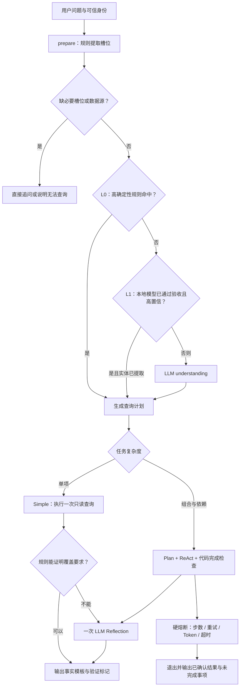

# Agent 槽位预检、分层路由与低成本验证改造

## 本轮结论

已接入槽位预检、L0 规则路由、脱敏槽位摘要、Reflection 规则预过滤、退票知识与会员优惠知识隔离、座位异常退出，以及可重复运行的离线统计脚本。

L1 已提供 fastText 推理接口、训练脚本和独立验收门槛，**默认关闭，尚无训练完成并通过验收的模型**。现有 144 个问法来自 72 组语义场景；标准、口语改写必须归在同一数据分区，不能一份用于训练、另一份用于测试。

本轮运行本地测试和冻结问题集的路由检查，未新增 Qwen / rerank 付费评测。旧版 288 次真实评测保留为基线，不能用作改造后的准确率。

## 1. 新链路



### 预检规则

- 查询本人订单、具体订单退票资格，且上下文没有可信用户提供的订单号：直接追问订单号。
- 查询座位，但既没有场次编号，也没有可用于找场次的影片、影院或日期：直接追问场次。
- 有影片、日期等信息的座位问题允许先查场次，再查座位；不会一律要求用户先提供 ID。
- 明确给出不存在的日期：直接追问有效日期，不扩大为不限定日期的查询。
- “周末”“最近”“过几天”等时间未被确定性解析：要求补充日期；包括座位发现问题。
- 没有日期的普通“有哪些可购场次”仍可使用已有业务默认范围，日期并非所有 screenings 查询的必填项。
- 会员、优惠、积分等未接入的数据源：明确说明无法确认权益。

旧日志中的 38 次澄清已经跳过 decision 和 Reflection，新增预检主要消除这些场景的 understanding 调用，不能重复计算已经省去的阶段。

### L0 路由与组合任务

问候、明确订单号查询、明确场次 ID 的座位查询、带影片名的资料字段查询、明确日期的场次查询、明确退票规则查询可由规则处理。

多个业务目标、多个订单、多个影片以及需要理解上下文的表达保留模型理解。“订单花了多少钱”不会额外查场次票价；“谁拍的、得看多久”会查询并展示导演与片长。

修正了离线检查发现的口语组合漏识别，例如“最早那场还剩多少座”“排了啥场”“几号场多少钱，再说退票提前几分钟”。这些不能因命中一个高频意图而遗漏其他要求。

## 2. 脱敏槽位摘要

prepare、上下文事件、结构化响应和追踪输出增加 `understanding_layer`、`preflight_reason`、`slot_summary`。

```json
{
  "understanding_layer": "preflight",
  "preflight_reason": "missing_order_no",
  "slot_summary": {
    "order_no": false,
    "screening_date": null,
    "screening_id": false,
    "movie_query": false,
    "cinema_query": false,
    "missing_slots": ["order_no"],
    "policy_kind": "none"
  }
}
```

这里只记录槽位是否存在、缺失类型和有限枚举。订单号、实际日期、影片名、问题正文不会进入新增摘要。追踪端再次执行白名单过滤，拒绝通过枚举或 missing_slots 携带任意业务文本。

`screening_date=true` 表示存在有效日期，`null` 表示没有有效日期，不记录日期值。旧日志无法恢复此摘要，统计显示 `unobserved`，不会根据已脱敏内容猜测用户原话。

## 3. Reflection 分层验证

规则验证只覆盖 L0/L1 得出的简单单项任务，并要求：任务清单完成、工具执行无错误、只有一个证据块、答案严格等于事实模板。

- 影片：检查用户请求的导演、片长等字段是否真实存在；查无影片可作为正确的否定结果。
- 场次：依业务契约校验日期、范围和必要字段后，空列表可作为正确的查询结果。
- 座位：检查座位编号唯一、状态合法；没有可选座位可正确返回，不因“可选数为零”自动判失败。
- 订单：检查状态以及用户请求的金额、开场时间、影片等字段；退票资格同时要求资格字段和原因。
- 退票规则：要求实时规则正文、版本和截止分钟参数齐全；涉及手续费、到账、办理流程等问题继续交给语义 Reflection。
- 连坐、位置偏好、复杂计算、组合任务、证据不完整及其他不能证明满足要求的情况继续使用原 LLM Reflection。

新标记为 `rules_passed`、`rules_empty`、`rules_incomplete`。规则通过表示该检查范围内满足条件，**不等同于独立事实准确率**。复杂链路仍保留原有 Reflection。

## 4. 票务规则与座位专项

### Policy 分型

公共九类意图保持兼容，通过 `policy_kind` 区分 `ticket_policy`、`general_policy`、`mixed`。

- 纯退票知识：`query_ticket_policy` 使用 KeywordRetriever 与业务知识关键词候选，跳过 rerank；退票事实仍以 Java 当前规则正文和数值参数为准。
- 其他已有购票知识查询继续使用原检索流程。
- 纯会员、优惠、积分问题在未接入数据源时直接说明无法确认；知识模板也不再把相关片段渲染成已确认权益。
- 退票与会员优惠混问：回答可核实的退票部分，并明确说明其他权益尚无法确认。

### Seats 异常处理

Java 现有实时座位接口会先检查场次是否存在、是否停售、开场时间及影院/影厅状态，复用此检查，避免增加一次额外业务请求。

- 座位接口返回 404/409 或对应业务错误码：MCP 归一化为 `screening_unavailable`，Agent 直接结束并提示换场次，不继续重试或调用 Reflection。
- 有座位数据但可选数为零：提示当前没有可选座位，请换场次或稍后刷新；不会把全部锁座说成全部售出。
- 座位列表为空：提示未取得数据，不能据此判断售罄，标记结果不完整。
- 有合法实时座位：保留查询快照提示；查询结果不承诺已经锁座。

## 5. 硬熔断继续生效

本轮快路径没有放宽原有代码上限：复杂任务最多 5 步、最多 3 次无效参数尝试、最多 4 次业务工具调用、最多 8 次模型调用、最多一次 Reflection；Simple 最多一次业务查询。模型调用还受 Token 和请求超时预算限制。

超过阈值立即停止后续调用，保留已确认数据，并披露未完成项。重复调用和无进展检查继续执行。

## 6. 验证与可量化结果

### 本地回归

171 项回归测试通过，覆盖槽位预检、口语组合分流、数据脱敏、规则验证、停售场次退出、L1 缺模型回退、训练分区泄漏拒绝，以及原有熔断边界；修改文件的 Ruff 检查通过。原有专门验证 LLM Reflection 行为的测试显式关闭快路径，新增测试单独验证默认开启的快路径。

测试日志：`cinema-ticketing-backend/target/agent-cost-optimization-validation.log`。

### 冻结 144 题的离线路由检查

- 64 题命中 L0，17 题命中前置预检，共 81/144 题无需新增模型理解。
- 这 81 题的意图及预期工具/参数均匹配：81/81。
- 标准问法快路径 41/41 匹配；口语问法快路径 40/40 匹配。
- 剩余 63 题保留模型理解或原有回退路径。

以上只验证计划与冻结验收定义的一致性，未执行这 144 题的真实业务查询和模型回答，不能宣称全量意图准确率或新任务成功率达到 100%。

### 利用旧用量推算 understanding 节省空间

按相同问题各运行两轮的旧记录，对新快路径做映射：

- 原 understanding 调用 286 次，其中 162 次可由新快路径避免，预计剩余约 124 次，下降约 56.6%。
- 可避免的历史输入 Token 为 198,718，输出 Token 为 26,085，合计 224,803。
- 原 understanding 已知总 Token 为 400,831，映射后的剩余量约 176,028，下降约 56.1%。

这是历史用量映射，**不是新版本的真实耗时、费用或准确率**。尚未验证“降到 100 次以内 / 15 万 Token”的目标，L1 也尚未贡献收益。Reflection 的节省不作未经实际运行的外推。

### 旧版真实基线复算

统计脚本复算原有 288 次记录：严格任务成功率 88.2%，关键事实通过率 97.9%，工具链正确率 88.9%，澄清率 13.2%（38/288）。Chat 模型调用 698 次，已知输入/输出 Token 为 1,201,145 / 87,674，另有 2 次调用缺少供应商用量；44 次 rerank 记录单列。

同日原始追踪按 run_id 去重后得到 291 个 local 会话轮次，包含 3 个不在冻结评测中的轮次，因此不与 288 次评测混用分母。仅靠脱敏追踪无法独立判定答案和任务准确率。

## 7. 使用统计与路由脚本

以下命令在 `cinema-ticketing-backend/cinema-ai` 目录执行。输出为 JSON 和 Markdown，不生成 TS 文件。

```powershell
# 复算带独立验收标签的历史评测
./.venv/Scripts/python.exe -m evaluation.eval_traces ../target/agent-evaluation/reflection-expanded-20261011 --output ../target/agent-evaluation/cost-optimization-20261011/baseline

# 分析导出的脱敏追踪；按 run_id 合并创建、更新与日/会话重复归档
./.venv/Scripts/python.exe -m evaluation.eval_traces '../../langsmith(tracing)/2026_10_11' --environment local --output ../target/agent-evaluation/cost-optimization-20261011/local-traces

# 比较新旧有标签评测；样本规模不同时优先比较单次均值
./.venv/Scripts/python.exe -m evaluation.eval_traces <新的评测目录> --output <报告前缀> --baseline <旧报告.json> --min-task-success 0.90

# 无外部请求的冻结路由检查
./.venv/Scripts/python.exe -m evaluation.routing_audit ../target/agent-evaluation/reflection-expanded-20261011/cases.json --date 2026-10-11 --output ../target/agent-evaluation/cost-optimization-20261011/routing-audit.json --historical-trials ../target/agent-evaluation/reflection-expanded-20261011/trials.jsonl
```

统计脚本区分执行结束率、验证器通过占比、独立任务成功率、关键事实通过率、工具链正确率及多余调用率。缺乏独立标签的指标显示不可判定；不能用“流程正常结束”替代准确率。验收门槛在没有完整任务标签时也不会通过。

## 8. L1 后续训练与启用条件

语料采用 JSONL，每条需要 `question`、九类之一的 `intent`、`scenario_id`、`split`。split 为 `train`、`validation`、`test`，同一语义场景及其口语改写必须留在一个分区。预处理后的等价问题也禁止跨区。

当前训练脚本要求每类至少 5 个训练、3 个验证、3 个测试独立场景。这只是数据预检底线；部署还要求验证、测试各至少 30 个高置信样本，接受集精度至少 98%，每类有足够支持且满足精度检查。九类数据偏斜或难例不足时，应继续收集，不能用改写数量冒充独立样本。

```powershell
# 先审计标注与分区；此步骤无需 fastText 依赖
./.venv/Scripts/python.exe -m evaluation.train_intent_classifier <已标注语料.jsonl> --output data/models/intent.bin --audit-only

# 安装兼容本机 Python 的 fastText 依赖后，本地训练并生成验收清单
./.venv/Scripts/python.exe -m evaluation.train_intent_classifier <已标注语料.jsonl> --output data/models/intent.bin --threshold 0.85
```

只有模型 SHA256 匹配、九类标签完整、清单标记通过部署验收且预测超过已验证阈值，运行时才接受 L1。缺文件、缺依赖、低置信或验收失败均升级给 LLM，不能靠调低环境阈值绕过已验证阈值。L1 只做分类，不猜订单号、场次 ID、日期或影片名。

当前仅允许实体已由规则提取且与规则意图一致的 movies / screenings / recommend 走 L1；订单与座位等明确 ID 场景优先由 L0 处理。fastText 使用 `train_supervised`、`predict` 和 `save_model` / `load_model`，接口依据 [fastText 官方 Python 文档](https://fasttext.cc/docs/en/python-module.html)。

## 9. 配置与生效

`.env.example` 已补充：

```dotenv
AGENT_L0_ENABLED=true
AGENT_RULE_VERIFIER_ENABLED=true
INTENT_L1_ENABLED=false
INTENT_L1_MODEL_PATH=data/models/intent.bin
INTENT_L1_THRESHOLD=0.85
```

L0 与规则验证器默认启用；L1 默认关闭。本轮没有修改实际 `.env` 或重启正在运行的服务，代码需要由下一次启动的 Agent / MCP 进程加载。关闭 L0 或规则验证开关可分别回退相应快路径，必要槽位与数据源预检仍保留。

后续真实复测应使用同一冻结问题集、相同数据和新输出目录，分别观察任务成功率、关键事实通过率、工具链正确率、多余调用率、澄清合理性、各阶段 Token 和 P50/P95。未做真实复测前，以上旧版准确率与离线路由结果应分别陈述。
