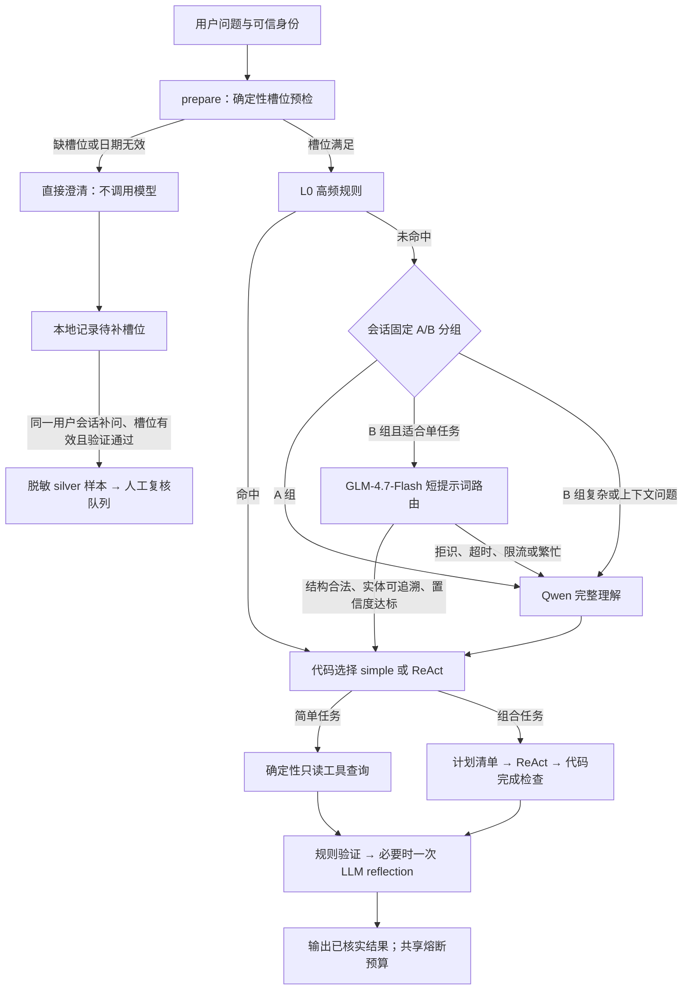

# GLM 前置路由、Golden 集、澄清回流与 A/B

更新日期：2026-10-11。实现目录：`cinema-ticketing-backend/cinema-ai`。

## 1. 本次完成的链路



GLM 只替代合适问题的 `understanding`，不回答业务事实、不执行工具。Simple 和组合任务继续使用现有完成检查及 reflection 机制。

### GLM 接管范围

- 优先处理没有历史依赖的影片资料、列表、简单场次等高频查询。
- 明确订单号、场次编号、带书名号的影片字段问题通常已由 L0 处理，不必再调 GLM。
- 组合、排序比较、连座、代词补问、推荐、退票规则、未接入的会员优惠等不交给 GLM 接管。
- 默认阈值 `0.90`；同时检查 JSON schema、单任务标志、查询范围、实体是否为用户原文片段。
- 日期和业务编号由确定性规则提取，身份来自服务端，分类器不能提供这些值。
- `confidence` 是模型自报分数；接管准确率必须由独立验收集测量。

密钥读取 `api/glm.txt`，也支持服务端 `GLM_API_KEY` / `GLM_API_KEY_FILE`。使用官方 `glm-4.7-flash` 模型名、官方 API 地址与 JSON 输出格式，见 [GLM-4.7-Flash 文档](https://docs.bigmodel.cn/cn/guide/models/free/glm-4.7-flash) 和 [对话补全 API](https://docs.bigmodel.cn/api-reference/模型-api/对话补全)。

前置请求只发送当前问题及短路由提示词，替换订单号，不携带用户身份、历史对话或数据库查询结果。

### 调用与熔断

- GLM 每个请求最多尝试一次，SDK 自动重试为 0。
- 默认超时 6 秒，代码限制配置最大 8 秒。
- 单个事件循环同时最多一个 GLM 请求，繁忙时直接升级 Qwen，不排队。
- 限流后进程内冷却 30 秒；超时后冷却 10 秒，期间直接跳过 GLM。
- GLM 成功、失败、超时都计入整项任务的模型调用与 Token 预算；缺失 usage 保留保守预留，不能记作零消耗。
- GLM 局部超时允许升级 Qwen；整项任务的总超时、Token 上限、最多 8 次模型调用仍然强制执行。
- Simple 默认模型预算为 2 次；若已发生 GLM 拒识并升级 Qwen，最多额外留 1 次给 reflection，同时受全局上限约束。
- ReAct 最大 5 步、无效调用最多 3 次、reflection 最多一次继续生效。

关键实现：`app/glm_router.py`、`app/intent.py`、`app/react_agent.py`、`app/agent_budget.py`。

## 2. Golden v1：168 条

位置：`evaluation/golden/v1/`。

- 原固定评测集 144 条，新增澄清后补问 24 条，共 168 条。
- 标准表达 84 条、口语表达 84 条，覆盖现有 9 类意图。
- 原 38 次澄清记录全部收录在 `observed_clarifications.json`，对应 19 个不同问题、每题 2 轮。重复轮次不增加问题数。
- 新增补问覆盖订单号、场次编号、有效日期各 8 条；沿用原场景编号，整个集合仍是 72 个独立场景。
- 保留独立定义的预期工具、参数与答案检查。曾经发生澄清，不意味着正确行为必须是澄清。
- 真实订单号已替换为 `OGOLD000001` 等占位符。私有绑定文件存放在被忽略的 `target` 目录，不进入 golden。

冻结业务日期为 **2026-10-11**。影片、场次、座位与订单验收依赖原业务快照，不能直接拿变化后的数据统计准确率。清单和快照都有 SHA-256 校验；实时评测入口先检查业务数据是否仍一致。“明天”等问句还依赖基准日期，跨日期运行时需更新日期敏感的验收并生成新版本，入口会拒绝沿用旧日期。

这个集合用于保留验收，不用于训练或阈值调参。训练脚本已增加 golden 重合与未复核 silver 样本拦截；标准/口语及补问变体按 `source_case_id` 隔离，避免同场景泄漏。

## 3. 澄清补问自动回流

默认开启，落地本地 SQLite：

`cinema-ticketing-backend/data/agent-feedback/clarifications.sqlite3`

不额外调用模型。满足以下条件才形成候选样本：

1. 原请求以 `needs_user` 结束，缺订单号、场次编号或有效日期。
2. 30 分钟内，同一可信用户和会话补问，传入历史确实包含原问题。
3. 新回复本身提供有效槽位，意图与原任务兼容。
4. 后续查询通过规则或 reflection 验证，正常结束，没有业务错误。

记录原问题、补问、补齐槽位名、原始与完成版本指纹。订单号、手机号、邮箱和常见凭证会替换；不记录登录令牌、工具返回的业务行或原用户身份。同样的问题对只累加 `occurrences`，不会重复生成样本。换话题和过期请求不会配对。

**用户补充的槽位可以作为弱标签，但不能自动证明全部意图与答案正确。** 因此保存为 `label_quality=silver`、`requires_review=true`，不自动加入 golden 或训练集。回流标签没有新增模型调用成本，人工复核仍然需要投入。

也修复了补问意图继承：退票查询追问订单号后，用户回复“订单号是…”“给你单号…”“就这单”，继续查询退票资格；明确改问状态时按新问题处理。

### 导出与复核

在 `cinema-ai` 目录运行：

```powershell
# 导出脱敏候选，不调用模型。
./.venv/Scripts/python.exe -m evaluation.export_clarifications --output ../target/agent-feedback/silver.jsonl

# 人工查看后，明确标记某一候选已复核。
./.venv/Scripts/python.exe -m evaluation.export_clarifications --approve <候选ID> --reviewed-only --output ../target/agent-feedback/reviewed.jsonl
```

复核后的槽位样本仍需整理为独立场景、补齐意图标签及 train/validation/test 划分，才能交给训练脚本。当前 GLM 路由不依赖本地训练。

## 4. Prompt / 规则版本与 A/B

提示词外置在 `prompts/v1/`：`understanding.txt`、`decision.txt`、`reflection.txt`、`glm_router.txt`。原 Qwen 三段提示词保持原文；整个提示词包在进程内一起固定。

版本注册：`config/agent_versions.json`。

- 实验：`glm-l1-v1`。
- Prompt：`cinema-p1`；规则：`cost-r1`。
- A：L0 + Qwen，保留现有查询和 reflection。
- B：相同流程，在适合的请求上增加 GLM 前置路由。
- 默认 B 流量 50%，按可信 `user_id + session_id + experiment_id` 的哈希固定分组，后续补问进入同组。

响应和脱敏 trace 都记录 `runtime_version`：实验组、版本号、提示词/规则/配置哈希；另记 `l1_status`、耗时及是否尝试。不输出用于分组的原身份。

改提示词或规则时创建新版本目录/实验编号，并更新注册与代码版本常量。代码和提示词需要进程重新加载；不要在同一个实验中热改规则。哈希可以识别未升版本号的改动；A/B 报告拒绝把多个版本指纹混在一起比较。评测还会留存实际源码、提示词和配置快照，恢复运行时检查是否变更。

### 默认开关与回退

`.env.example` 已增加配置；实际 `.env` 未写入密钥。未显式设置的选项采用代码默认值，AI 服务加载新代码后使用：

```dotenv
GLM_L1_ENABLED=true
GLM_API_KEY_FILE=../../api/glm.txt
GLM_L1_THRESHOLD=0.90
GLM_L1_TIMEOUT_SECONDS=6
AGENT_AB_ENABLED=true
AGENT_AB_B_PERCENT=50
AGENT_AB_FORCE_VARIANT=
CLARIFICATION_FEEDBACK_ENABLED=true
```

关闭前置 GLM：`GLM_L1_ENABLED=false`。强制全部走 A：`AGENT_AB_FORCE_VARIANT=A`。全部走 B：`AGENT_AB_FORCE_VARIANT=B`，或关闭 A/B 分流。强制分组只读服务端环境，客户端不能选组。

## 5. 同题 A/B 评测入口

已扩展 `evaluation.run --baseline-mode glm-ab`，两组使用相同源码、同一题集，顺序交替，只改变 GLM 分组。GLM usage 单独记为 `stage=glm_l1`。统计包含失败调用；缺失 usage 单独报告。费用保留 Qwen 子项，GLM 不套用 Qwen 单价，也不把未知账单当成免费。

以下命令会发起真实模型调用，**本轮没有执行这批完整评测**：

```powershell
./.venv/Scripts/python.exe -m evaluation.run --baseline-mode glm-ab --manifest evaluation/golden/v1/cases.json --snapshot ../target/agent-evaluation/reflection-expanded-20261011/snapshot.json --bindings ../target/agent-evaluation/glm-l1-20261011/private-bindings.json --repeats 1 --output ../target/agent-evaluation/glm-ab-golden-v1

./.venv/Scripts/python.exe -m evaluation.ab_report ../target/agent-evaluation/glm-ab-golden-v1 --output ../target/agent-evaluation/glm-ab-golden-v1/comparison
```

一轮完整对比为 168 × 2 = 336 次任务；两轮为 672 次。应单独确认本次数据外发范围和任务量后运行。此前 144 题、288 次的授权不自动扩为这轮新增问题和双版本评测。

报告区分任务成功率、事实检查、工具链、额外调用、澄清率、阶段 Token、平均模型调用及首字/完整回答 P50/P95；JSON 进一步按标准/口语和意图分组。独立答案验收仍以冻结检查项及记录关联检查为基础，不等同于人工逐句事实审核。

线上无 gold 标签的 trace 只能报告结束率、澄清率和资源消耗，不能直接生成事实准确率。可以用 `--environment` 选择部署环境。只有同版本、同问题与轮次的结果才适合成对比较。

## 6. 本轮验证结果

- 全部 **205 项测试通过**：原 171 项回归 + 新增 34 项针对 GLM、回流及 A/B 的测试；Ruff 检查通过。
- 新增覆盖真实图中的 GLM → 工具 → reflection、GLM 拒识 → Qwen → reflection、总预算熔断，以及澄清补问的生产回流钩子。
- Golden 离线路由审计：168 条中 96 条进入规则/预检；这 96 条的意图与预期工具计划全部匹配。其余 72 条仍需模型或完整理解，本次未据此计算业务回答准确率。
- 标准题 49 条、口语题 47 条由规则/预检处理，工具计划分别全部匹配。这是接管子集的路由检查，不能解释为全部标准/口语问答准确率。
- 最新四条公开影片合成问题：两条被 GLM 成功接管（约 1.70 秒、1.19 秒，provider usage 459、460 Token）；第三条返回 1305，第四条因冷却跳过。此检查不含数据库、Qwen 或完整问答。
- 智谱官方将 1305 定义为模型当前访问量过大，见 [错误码文档](https://docs.bigmodel.cn/cn/faq/api-code)。已验证这类问题会走受限回退，不能从这四题推算整体接管率或节省比例。

验证日志：`cinema-ticketing-backend/target/agent-glm-validation.log`。

离线路由报告和 GLM 合成检查：`cinema-ticketing-backend/target/agent-evaluation/glm-l1-20261011/`。

本次完成代码、固定集合、回流闭环与对比工具；新的端到端成功率、Token 降幅和成本收益，需完整同题 A/B 后再发布。
