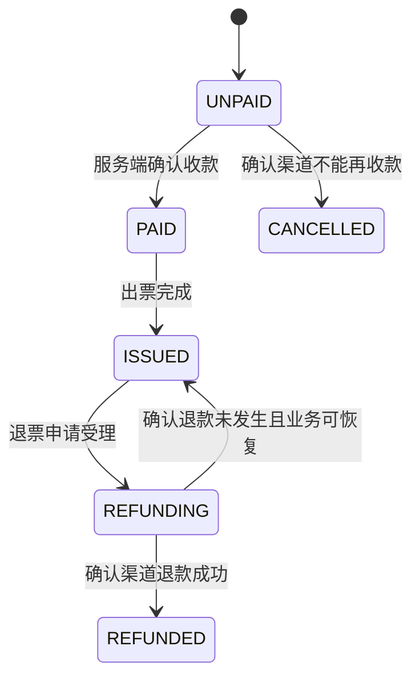
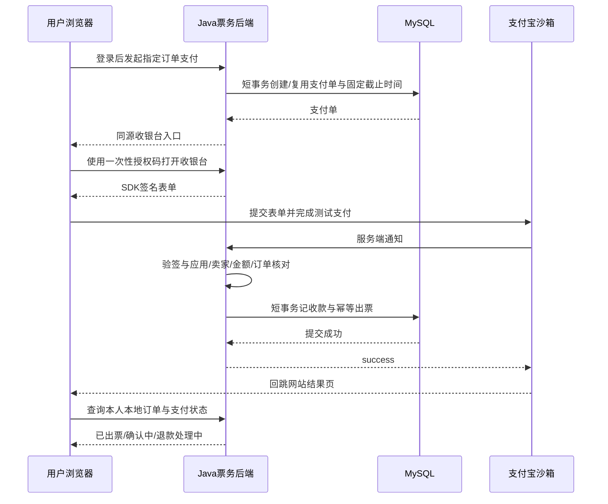

# 影院项目支付宝沙箱接入与正式支付替换方案

更新日期：2026-10-16。本文根据当前仓库源码与支付宝官方资料整理，是待实施方案；尚未添加支付 SDK、配置商户密钥、修改数据库或调用沙箱接口。

## 1. 推荐路线与实施范围

建议在现有 Java 后端内新增支付模块，首版接入 **支付宝电脑网站支付 `alipay.trade.page.pay`**，完成支付发起、服务端通知、主动查单、超时关单、整单退款和退款查询。React 负责跳转收银台与展示本地订单结果，Java 负责金额、签名、确认和状态推进。

首版按“一个经营主体、一个收款商户、多个自有影院、人民币、整单支付及整单退款”设计。手机浏览器支付可在下一阶段按实际产品权限增加 `alipay.trade.wap.pay`；不因存在 AI 助手就引入另一套智能体支付产品。

沙箱调用的接口、签名、通知和查单流程可以用于真实集成验证，但资金仍是测试资金。切换正式收款还需要正式应用、对应产品权限及正式商户配置。支付宝当前沙箱说明明确区分了沙箱与生产配置，并提供独立测试账号。[官方沙箱与配置说明](https://aipay.alipay.com/products)

现有影片、影厅、座位和订单仍以本项目数据库为依据。支付宝接入解决收款确认，不会自动接通外部影院排期、真实库存和第三方出票系统。若业务是销售其他经营者影院的票，还需单独解决影院合作、库存接口、出票与商户结算关系。

## 2. 当前实现与准确替换位置

### 2.1 两个前端支付入口

[App.tsx](E:/development/AI-Project/cinema-ticketing-frontend/src/App.tsx:505) 的 `payActiveOrder()` 调用 `/api/orders/{orderNo}/pay`，提交 `DEMO-{orderNo}`，接口返回后直接显示支付成功并出票。

同文件 [runOrderAction()](E:/development/AI-Project/cinema-ticketing-frontend/src/App.tsx:561) 也会构造演示流水号。改造必须同时覆盖首次支付与订单列表的“继续支付”，让两个入口共用同一个收银台发起函数。

替换后的动作应是：请求后端创建或复用支付单 → 获取收银台入口 → 跳转支付宝 → 回站查询本地状态。发起请求成功只能显示“正在前往支付”，不能显示“支付成功”。

### 2.2 支付控制器与请求体

[OrderController.java](E:/development/AI-Project/cinema-ticketing-backend/src/main/java/com/cinema/ticketing/controller/OrderController.java:54) 当前收取用户 Token 和前端 `paymentNo`，直接调用 `orderService.pay()`。

新增支付发起接口后，浏览器仅提交订单号及可选幂等请求号。金额从数据库读取，收款应用与商户由服务端配置选择，支付宝交易号来自验签通知或可信查单。现有模拟 `/pay` 接口应仅在明确的本地 MOCK 模式开放；沙箱与生产环境必须禁止该接口直接确认成功。

### 2.3 支付成功的本地写库逻辑

[OrderService.pay()](E:/development/AI-Project/cinema-ticketing-backend/src/main/java/com/cinema/ticketing/service/OrderService.java:112) 当前直接插入 `SUCCESS` 支付流水，并在同一事务内完成 `UNPAID → PAID → ISSUED`，随后删除 Redis 锁。

其中写支付事实、出票、更新票项的能力可以提取复用，但调用入口必须改为服务端支付确认。不能将现有方法原样作为支付宝回调方法：它需要用户身份参数、以本地当前时间判断订单过期，而且把 Redis 解锁放在数据库事务中。

建议提取 `PaymentSettlementService.confirmPaid()`，仅接受经过渠道适配层验证的结果。通知和主动查单都调用这一方法，避免形成两套出票逻辑。

### 2.4 退款成功的本地写库逻辑

[OrderService.refund()](E:/development/AI-Project/cinema-ticketing-backend/src/main/java/com/cinema/ticketing/service/OrderService.java:149) 当前验证退票规则后，直接将订单及票项改为 `REFUNDED`，再插入退款成功记录；没有调用资金渠道。

需要将它拆成退款受理、渠道退款、退款确认三个阶段。已有订单归属、已验票限制和截止时间校验可继续作为受理条件；只有确认渠道退款成功后才能落最终退款事实。

### 2.5 主动取消、延迟取消与定时兜底

需要统一改造以下三个入口：

- [主动取消](E:/development/AI-Project/cinema-ticketing-backend/src/main/java/com/cinema/ticketing/service/OrderService.java:296)。
- [延迟消息取消](E:/development/AI-Project/cinema-ticketing-backend/src/main/java/com/cinema/ticketing/service/OrderService.java:246)。
- [定时扫描兜底](E:/development/AI-Project/cinema-ticketing-backend/src/main/java/com/cinema/ticketing/service/OrderReconciliationJob.java:45)。

当前三个入口最终都可以直接改为 `CANCELLED` 并释放座位。接入外部支付后，它们应进入统一的查单与关单流程，确认资金状态后再决定出票、取消或补偿退款。

### 2.6 数据库与报表

[schema.sql](E:/development/AI-Project/cinema-ticketing-backend/src/main/resources/schema.sql:127) 的 `payment_transaction` 目前是成功支付事实表，每个订单最多一条记录。它缺少待支付生命周期、渠道、环境、应用和支付宝交易号等信息。

[ReportViews.java](E:/development/AI-Project/cinema-ticketing-backend/src/main/java/com/cinema/ticketing/dto/ReportViews.java:16) 将所有报表固定标记为 `SIMULATED`；导出和管理页也使用模拟文案。正式接入时应以持久化的环境与渠道字段区分历史模拟、沙箱、正式数据，避免改一处文案后把旧数据当成真实营收。

## 3. 接沙箱之前需要准备的材料

### 3.1 账号与应用

需要登录支付宝开放平台，进入当前沙箱应用控制台，准备：

1. 沙箱应用 `app_id`。
2. 沙箱卖家身份，记录本次应用对应的卖家 UID / `seller_id`。
3. 沙箱买家账号、登录密码和支付密码，确保买家与卖家不是同一个测试身份。
4. 沙箱提供的测试余额或充值测试能力。
5. 当前沙箱应用对电脑网站支付、查单、关单、退款和退款查询的支持情况。
6. 需要扫码测试时使用的支付宝沙箱客户端。以控制台当日提供的下载入口与终端支持为准，不默认正式版支付宝可以支付沙箱订单。

沙箱能力应以该应用控制台实际显示为准。平台有沙箱功能，不代表任意产品均支持同样的测试范围。正式应用创建与产品权限还有独立流程。[官方应用接入流程](https://open.alipay.com/module/webApp)

### 3.2 签名配置

首版可在控制台支持的情况下采用 RSA2 公钥模式，准备三项不同用途的密钥材料：

- **应用私钥**：由开发者生成，Java 服务用它对请求签名；不能放进 React、提示词、Git 或公开日志。
- **应用公钥**：与应用私钥配对，上传到对应沙箱应用，让支付宝验证商户请求。
- **支付宝公钥**：从该沙箱应用的配置中获取，服务端用它验证支付宝响应与通知。

应用公钥与支付宝公钥不是同一把公钥。Java 使用与 SDK 要求匹配的 PKCS8 私钥格式，字符集统一 UTF-8，签名类型统一 RSA2。

如果所选应用使用证书模式，应准备应用公钥证书、支付宝公钥证书、支付宝根证书，并使用 SDK 对应的证书调用与验签方法。正式环境是否继续使用公钥模式，应由实际应用配置决定。支付宝官方 Java SDK 同时说明了两种模式所需材料。[官方 Java SDK](https://github.com/alipay/alipay-sdk-java-all/tree/master/v2)

### 3.3 地址与网络

准备两个用途不同的地址：

- `notify_url`：支付宝服务器向 Java 发 POST 通知的地址，例如 `https://sandbox-api.example.com/api/payments/alipay/notify`。
- `return_url`：支付后浏览器回到网站的页面，例如 `https://sandbox.example.com/payment/result`。

示例域名只是占位。`notify_url` 需要从公网访问，可先使用可信的 HTTPS 内网穿透入口，也可以部署独立测试环境；`localhost`、`127.0.0.1` 和局域网地址不能作为支付宝服务端回调入口。

确认公网入口没有登录跳转、验证码页面、错误的 HTTP→HTTPS 跳转或响应包装。HTTPS 推荐直接到达正确路径，转发时保留原始表单参数。仅开放必要的网站和回调入口，不为回调开放数据库、Redis、RabbitMQ 或内部 AI 接口。[官方异步通知说明](https://developer.alibaba.com/docs/doc.htm?articleId=105902&docType=1&treeId=270)

### 3.4 项目与测试数据

准备可运行的 Java 21、MySQL、Redis、RabbitMQ 和前端环境，以及：

- 一个可登录的购票用户。
- 一部可售影片、一个有效场次、足够的可选座位。
- 与测试当天匹配的开场时间，避免场次已过期或退票截止时间已到。
- 独立沙箱数据库和缓存、消息隔离范围。
- 可查看的服务端请求、回调、查单与退款诊断日志。
- 配置与数据库变更的回退方案。

沙箱订单会占用座位并产生支付、退款事实，因此正式售票环境应与沙箱隔离，不能只更换支付宝网关而共用真实库存。

## 4. 支付产品与 SDK 的选择

本项目是 React 浏览器网站，建议优先验证电脑网站支付，产品码使用接口规定的 `FAST_INSTANT_TRADE_PAY`。服务端用 SDK 生成收银台表单，浏览器提交到支付宝。生成表单本身没有发生付款，也不一定已经在渠道侧创建交易。[官方电脑网站支付指南](https://developer.alibaba.com/docs/doc.htm?articleId=105899&docType=1&treeId=270)

`alipay.trade.precreate` 属于另一种支付接入方式，不能因为想显示二维码就假定当前应用具备相应权限。PC 网站支付本身可由支付宝收银台展示支付入口；首版采用完整跳转，减少自行嵌入二维码页面的复杂度。

Java 可采用官方 `com.alipay.sdk:alipay-sdk-java`。本次查看的官方 v2 README 示例版本为 `4.40.994.ALL`，可作为实施时检查的候选；应核验依赖树和 Java 21 兼容后固定版本，不使用动态 `LATEST`。[官方依赖说明](https://github.com/alipay/alipay-sdk-java-all/tree/master/v2)

这里的 SDK v2 指支付宝 API 协议版本，与 RSA2 签名算法不是同一个概念。本方案按 v2 的页面支付、表单通知与 SDK 验签设计，不混用 v3 的 HTTP 报文签名规则。

## 5. 建议的模块与职责

继续使用当前 Java 单体部署，在其中增加以下职责。名称为建议命名，文件尚未创建：

- `PaymentController`：用户支付发起、支付状态与受控同步查询。
- `AlipayNotifyController`：接收表单通知，返回支付宝规定的纯文本结果。
- `PaymentFacade`：编排短事务、渠道操作与结果确认，不包住整个网络流程开数据库事务。
- `AlipayPaymentChannel`：封装 SDK 的页面支付、查单、关单、退款和退款查询。
- `PaymentSettlementService`：在本地事务中核对支付结果、记录收款事实、幂等出票。
- `RefundService`：退款资格受理、稳定退款单号、结果确认与状态恢复。
- `PaymentReconciliationJob`：补查未确认支付和待关单交易。
- `RefundReconciliationJob`：查询结果未知的退款，推进重试或人工处理。
- `AlipayProperties`：校验当前环境、网关、应用、卖家和密钥配置。

渠道接口可以提供 `createCashier / queryPayment / closePayment / refund / queryRefund` 五项能力。首版只实现支付宝和明确隔离的本地 MOCK，不提前引入支付微服务、分布式事务协调器或多渠道路由平台。

所有渠道网络调用都放在数据库事务之外。先用短事务冻结意图或领取任务，提交后调用支付宝，再用短事务按版本与当前状态确认结果；通过稳定单号、幂等处理和补偿任务处理“两边无法原子提交”的问题。

## 6. 数据模型：订单、支付单与资金事实分开

### 6.1 保留 `ticket_order` 作为票务业务订单

订单金额、场次、座位和归属仍来自现有业务订单。新增退款处理中状态 `REFUNDING`；现有 `PAID` 用于“收款已确认、尚待出票”的业务阶段，正常本地出票可以在同一短事务完成到 `ISSUED`。

首版建议的普通状态变化：



关闭处理中可先存放在支付单，不必新增票务 `CLOSING` 状态。订单在渠道结果未确定时仍保留数据库座位占用，对外通过支付单展示“正在确认/取消处理中”。

例外：订单已经取消且座位释放后才发现已收款，保留取消事实，另记录收款与补偿退款；不能把它直接改回 `PAID`，否则当前按订单状态判断占座的 SQL 可能错误地重新占用已售给他人的座位。

### 6.2 新增 `payment_order`：记录支付生命周期

建议字段包括：

- `id / order_id / out_trade_no`：内部主键、业务订单关联、后端生成的商户支付单号。
- `channel / environment`：首版 `ALIPAY`，环境 `SANDBOX` 或 `PROD`；历史 MOCK 单独标识。
- `app_id / seller_id / credential_ref`：发起时使用的应用、卖家及服务端密钥版本引用，不存私钥正文。
- `amount / currency`：创建支付单时冻结的订单金额与 CNY。
- `status / channel_trade_status / channel_trade_no`：内部处理状态与渠道状态分别保存。
- `expire_at / paid_at / confirmed_at`：原订单截止时间、渠道支付时间、本地确认时间。
- `close_requested_at / close_reason / last_query_at / next_check_at`：取消与补偿调度。
- `retry_count / lease_until / version / last_error_code`：有限重试、任务租约、并发版本及受控错误码。

首版可以一笔业务订单只建立一笔支付单，重复点击复用相同 `out_trade_no`，不在旧支付仍可能成功时生成新支付单。以后扩展多次支付尝试，需要显式处理多个渠道交易同时成功的补偿，不能直接移除约束。

建议约束：`order_id` 唯一；`(channel, environment, app_id, out_trade_no)` 唯一；渠道交易号非空时按渠道、环境与应用约束唯一。服务端生成的编号使用足够随机性、满足渠道长度与字符要求。

内部支付状态可采用 `INIT / PAYING / CLOSING / SUCCESS / CLOSED / UNKNOWN`。网络超时进入待确认状态，不等同于付款失败；支付成功事实不能被迟到的待付款或关闭消息覆盖。

### 6.3 扩展 `payment_transaction`：保留成功收款事实

现表继续用于已确认成功的收款，避免把等待支付记录放进默认成功的表中。建议补充支付单关联、渠道、环境、应用、支付宝交易号、确认来源和确认时间。

`payment_no` 可以继续作为后端生成的内部收款记录号，支付宝 `trade_no` 放入独立的 `channel_trade_no`。同一成功事件的重复通知复用原记录，不重复生成流水。

当前 `UNIQUE(order_id)` 在“一单一渠道一支付单”的首版可以保留。如果未来确实发生第二笔渠道收款，不能简单吞掉唯一键冲突：应保存异常收款证据并触发核对或补偿退款。

退款后保留成功收款事实，通过退款记录表达资金退回；经营报表继续按支付日与退款处理日分别统计。

### 6.4 扩展 `refund_record`：不再默认代表退款成功

建议补充：退款单号 `refund_no`、支付单关联、渠道与环境、申请时间、确认时间、资格政策版本、原因类型、重试与租约字段。状态采用 `PENDING / UNKNOWN / SUCCESS / FAILED`，或者保留现有 `REFUNDED` 作为成功状态；实现时选择一个成功枚举并同步修改报表查询。

首版推荐为兼容现有报表，保留成功枚举 `REFUNDED`，新增 `PENDING / UNKNOWN / FAILED`，将新记录默认值改为 `PENDING`。`refunded_at` 仅在确认成功时填写。

`refund_no` 由后端生成并映射到支付宝 `out_request_no`，同一次退款的重试必须复用它。普通整单退票与“取消后收款”的补偿退款需要不同原因枚举，后者由系统职责发起，不套用普通用户退票截止时间。

### 6.5 新增通知处理记录

可新增 `payment_notify_event`，保存通知编号、关联支付单、受控状态摘要、处理结果和时间，按 `(channel, environment, app_id, notify_id)` 去重。业务处理仍要按支付单与交易号幂等，不能只靠 `notify_id`。

完整回调报文可能包含买家标识等信息，默认日志只记录必要摘要。确有核对需求时再设置受限、加密、有限保留期的原文存储。

## 7. 编号如何对应

建议保持清晰的四种业务编号：

1. 本地业务订单号 `ticket_order.order_no`：对应一次选座购票。
2. 商户支付单号 `payment_order.out_trade_no`：由 Java 生成并提交给支付宝。
3. 支付宝交易号 `trade_no`：渠道实际创建交易后返回。
4. 商户退款单号 `refund_no / out_request_no`：标识一次退款请求。

现有下单 `requestId` 继续解决重复创建业务订单。支付发起的幂等号可以用于请求去重，但不能充当渠道收款证明。前端不提交支付宝交易号来决定支付成功，也不提交退款金额来决定实际退款。

## 8. 建议的 HTTP 接口

### 8.1 发起支付

`POST /api/orders/{orderNo}/payments/alipay`。

需要登录；校验订单属于当前用户、仍允许支付、原截止时间有效。请求体仅包含可选的 `requestId`；服务端读取订单金额并创建或复用支付单。

返回可以包括 `orderNo / paymentNo / paymentStatus / cashierUrl / expiresAt / serverTime / environment`。这些是拟新增接口字段，不是支付宝原生返回结构。

### 8.2 收银台跳转

当前网站使用自定义 `X-Auth-Token` 请求头，直接 `window.location` 打开后端地址不会自动带该请求头。建议采用两步：

1. 已登录的支付发起接口返回同源 `cashierUrl`。
2. 地址包含短时、一次性收银台授权码，绑定指定支付单；浏览器访问后，由 Java 输出 SDK 生成的 HTML 表单。

例如 `GET /api/payments/checkout/{opaqueToken}`。授权码只赋予打开该支付单收银台的能力，不替代登录 Token；存哈希、设置短期有效期、原子消费，消费时再检查截止时间和关闭标记。重复点击可重新申请入口，但复用同一商户支付单号。

页面设置禁止缓存与不发送 Referer，访问日志对授权码脱敏。Java 输出可信 SDK 表单，不将完整站点登录 Token 放在 URL 中。React 不依赖 `dangerouslySetInnerHTML` 自动执行脚本；同页导航可避免异步打开新窗口被浏览器拦截。

### 8.3 异步通知

`POST /api/payments/alipay/notify`。

接收 `application/x-www-form-urlencoded`，不要求用户登录。支付宝没有本站登录态，因此鉴权依据是渠道签名与业务核对。该接口返回 `text/plain` 的 `success` 或失败结果，不使用项目普通 `ApiResponse` JSON 包装。[官方异步通知协议](https://developer.alibaba.com/docs/doc.htm?articleId=105902&docType=1&treeId=270)

公钥模式使用 SDK 的 `AlipaySignature.rsaCheckV1` 等匹配方法，证书模式采用对应证书验签方法。使用 Servlet 已解码参数，避免人为重复 URL 解码改变签名内容；遇到多值同名参数按接口约定处理，异常结构直接拒绝。

### 8.4 本地状态与主动同步

- `GET /api/orders/{orderNo}/payment`：登录后读取本人本地支付状态，供页面轮询。
- `POST /api/orders/{orderNo}/payment/sync`：登录后申请受控渠道查单；服务端做单笔频率限制，复用统一确认逻辑。

普通页面轮询只查本地状态，不让每一次浏览器轮询都调用支付宝。

### 8.5 退款

可保留 `POST /api/orders/{orderNo}/refund` 作为用户入口，但返回“退款处理中/已退款/无法受理”的实际状态。增加本人退款状态查询，提供稳定退款单号和受控原因。

只有金额由后端确定、资格已验证的退款记录才能进入渠道调用；不能提供一个让用户任意指定他人交易号和退款金额的通用接口。

## 9. 支付发起与确认的完整流程



服务端回调与浏览器回跳的实际先后顺序不固定。回跳页面只能展示后端查询结果；确认支付以已验证的服务端通知或主动查询为依据。[官方支付确认流程](https://developer.alibaba.com/docs/doc.htm?articleId=105899&docType=1&treeId=270)

确认支付时，应逐项核对：签名、应用、卖家、商户支付单号、金额、币种语义、关联订单及渠道交易状态。金额使用 `BigDecimal` 与冻结订单金额比较，不用浮点数，也不把用户优惠后的 `buyer_pay_amount` 当成本项目订单总额。

普通收款成功以 `TRADE_SUCCESS` 或 `TRADE_FINISHED` 表示；`WAIT_BUYER_PAY` 不能出票。`TRADE_CLOSED` 既可能是未付款关闭，也可能是付款后全额退款，需要结合已有收款事实与退款记录解释。状态含义来自支付宝通知协议；本地状态机是项目实现方案。[官方交易状态定义](https://developer.alibaba.com/docs/doc.htm?articleId=105902&docType=1&treeId=270)

本地确认事务统一锁定业务订单和支付单，采用一致锁顺序，完成成功流水去重、订单推进和票项出票。重复、乱序通知及补偿查单不能重复出票，也不能将 `SUCCESS` 降级为等待支付。

只有本地业务事务提交后，才返回 `success`。若采用先接收后异步处理，必须先将已验证事件与待执行任务可靠持久化，并有恢复任务；不能仅在内存开启线程就 ACK。

Redis 解锁放到数据库提交后执行，失败可重试或等待 TTL。已经成功收款并提交的订单，不应因 Redis 暂时不可用而回滚为未支付。本项目数据库的订单占座判断仍是防止再次出售的依据。

## 10. 5 分钟订单的支付竞态处理

### 10.1 所有付款入口使用原订单绝对截止时间

现有订单有效期与 Redis 锁都为 5 分钟。用户在第 4 分钟点击继续支付时，不应再得到新的完整 5 分钟。

建议把订单原始 `expire_at` 映射到支付宝 `time_expire`；不用每次点击重新设置相对 `timeout_express=5m`。官方页面支付模型支持绝对截止时间并优先使用它。该接口还存在最短超时时间要求，实施时需要按实际 SDK 与接口核验；本次官方模型注明下限 1 分钟，因此剩余时间不足时可停止发起新收银台并提示重新下单，不能自行向后延长截止时间。[官方页面支付参数](https://raw.githubusercontent.com/alipay/alipay-sdk-java-all/master/v2/src/main/java/com/alipay/api/domain/AlipayTradePagePayModel.java)

时间统一按北京时间写入和解释，保存渠道付款时间与本地确认时间。仓库 Dockerfile 已设置 JVM 为 Asia/Shanghai，本地运行与任务调度也需保持同一业务时钟并同步系统时间。

### 10.2 到期后的统一处理

1. 短事务标记支付单正在关闭，禁止新发起收银台；提交后调用渠道，避免持有数据库行锁等待网络。
2. 查到已经付款：进入统一支付确认，结合实际付款时间与占座情况决定出票或补偿。
3. 查到待付款：调用 `alipay.trade.close`。成功关闭后再用短事务取消业务订单并释放占座。
4. 关单遇到状态变化：重新查单；不能把“关单未成功”直接解释为“可释放座位”。
5. 网络超时、系统错误或暂时无法确认：保留占座和待核对状态，持久化下一次检查时间；达到处理时限后告警并进入受控人工处理。

支付宝关单适用于待付款交易；系统异常、交易不存在和状态不合法是不同结果，需要分别处理。[官方交易关闭接口](https://aipay.alipay.com/docs/vibe-pay/ai-web-app-payment-qianyi/api-list/alipay-trade-close.html)

现有 `CANCEL_GRACE=2s` 允许消息提前到达后就取消。改造后可用提前到达触发检查或重调度，但不能因此提前释放仍在有效期内的支付订单。

### 10.3 “渠道交易不存在”仍有浏览器延迟提交的竞态

页面支付表单可能已经生成，但浏览器尚未提交，因此此时查单可能显示交易不存在。如果立刻释放座位，浏览器稍后仍可能提交一个未过期的签名表单。

若订单从未创建支付入口，可以直接按现有条件取消。已经发放过支付表单的订单，需要结合绝对截止时间、是否有未消费入口、渠道关单结果和后续查单确认处理。截止前的“交易不存在”不能独立作为安全释放依据；仍无法排除晚到支付时继续核对或走明确的异常补偿流程。

### 10.4 支付通知晚到不等于付款超时

例如订单 10:05 到期、用户 10:04:58 完成付款、通知 10:05:10 到达。只比较通知到达时刻会错误拒绝有效付款。

应读取可信渠道付款时间，并检查数据库占座与订单状态。付款在有效期内、座位仍由本单占用且场次可履约时可继续出票；已经取消且座位释放、付款确实晚于截止或业务无法履约时，保存收款事实并创建补偿退款。不能从另一订单抢回座位，也不能把“已收钱”简单丢成失败日志。

## 11. 退款：受理、执行、确认与恢复

首版保持整单退款，退款金额由已确认收款金额和本项目整单规则决定。步骤如下：

1. 事务内校验订单归属、`ISSUED`、没有验票、仍符合当前退票政策，锁定订单与票项。
2. 创建稳定退款单，记录申请时刻、资格政策版本和原因，订单进入 `REFUNDING`；提交事务。
3. 事务外以原商户支付单号或支付宝交易号调用 `alipay.trade.refund`，传后端退款单号作为 `out_request_no`。
4. 渠道确认成功后，事务内将退款记录与订单、票项推进到成功，记录真实退款确认时间。
5. 调用超时或结果无法确认时保留 `UNKNOWN` 并主动查询，不对用户显示已退款。
6. 只有确定退款没有发生且业务可恢复时，才恢复可用订单；未知结果不能恢复验票或重新受理另一笔退款。

支付宝退款支持同一退款请求幂等；同一次退款重试必须保持请求号和金额一致。退款查询 `code=10000` 只代表查询调用成功，应核对 `refund_status=REFUND_SUCCESS` 等业务结果。查询过早可能尚无最终结果，官方建议与发起请求间隔至少约 10 秒。[官方退款接口](https://aipay.alipay.com/docs/vibe-pay/ai-web-app-payment-qianyi/api-list/alipay-trade-refund.html)、[官方退款查询](https://aipay.alipay.com/docs/vibe-pay/ai-web-app-payment-qianyi/api-list/alipay-trade-fastpay-refund-query.html)

`fund_change=N` 可能涉及重复请求，不能仅凭该字段判定失败，也不能因此创建新退款单。应查原退款请求并核对交易、退款单号和金额。

退票受理与验票必须沿用一致的订单行锁顺序。受理成功后禁止验票，同时保留占座，直到退款确认完成后才允许按业务规则重新出售。已受理退款的后续重试不会因跨过退票截止时间而重新变成普通资格拒绝；是否允许退票在申请受理时已形成可审计决定。

由于当前 SQL 只把 `UNPAID / PAID / ISSUED` 当成占座状态，新增 `REFUNDING` 后需要同步更新占座判断及影厅座位编辑约束，防止退款处理中被重新出售。验票必须拒绝 `REFUNDING`。相关位置包括 `OrderService` 的座位查询与冲突校验、`HallSeatService`、`TicketCheckInService`，以及订单显示和 AI 状态解释。

## 12. 对账、补偿与消息可靠性

当前 `OrderReconciliationJob` 只是本地过期取消兜底，不是支付宝资金对账。保留延迟消息触发的实时性，同时增加基于持久化支付状态的任务：

- 补查等待通知的支付单，统一进入支付确认。
- 对到期单执行查单、关单和状态核对。
- 查询未知退款，使用原请求号推进同一次请求。
- 处理 `PAID` 但未出票的业务补偿。
- 检测已取消但存在成功收款且未完成补偿退款的订单。
- 正式运营阶段按渠道账单核对支付、退款和差异。

任务需要租约或抢占，控制每批数量、重试间隔和最大等待；外部调用前后不长期持有行锁。回调、同步查单和定时任务共用同一确认服务及状态前进规则。

退款单的 `PENDING / UNKNOWN` 和支付单的 `CLOSING / UNKNOWN` 本身可以作为首版数据库任务来源。若改用 MQ 发起退款或出票任务，需要事务性持久化任务或 Outbox；当前订单取消消息是在 `afterCommit` 发布，存在提交后发布失败窗口，不能把它当成已经提供了资金操作的可靠 Outbox。

消息消费幂等记录应表示“已可靠接收并落下待处理任务”或“已完成操作”，语义要统一。渠道结果未知时，不应因记录了消费 ID 而永久阻止后续核对。

## 13. 配置与沙箱、正式环境切换

以下是拟新增配置示例，不是当前项目已具备的配置。密钥通过受控环境变量或只读密钥文件提供。

```yaml
payment:
  enabled: ${PAYMENT_ENABLED:false}
  provider: ${PAYMENT_PROVIDER:ALIPAY}
  environment: ${PAYMENT_ENVIRONMENT:SANDBOX}
  mock-enabled: ${PAYMENT_MOCK_ENABLED:false}
  alipay:
    gateway-url: ${ALIPAY_GATEWAY_URL}
    app-id: ${ALIPAY_APP_ID}
    seller-id: ${ALIPAY_SELLER_ID}
    private-key-file: ${ALIPAY_PRIVATE_KEY_FILE}
    alipay-public-key-file: ${ALIPAY_PUBLIC_KEY_FILE}
    sign-type: RSA2
    charset: UTF-8
    notify-url: ${ALIPAY_NOTIFY_URL}
    return-url: ${ALIPAY_RETURN_URL}
```

当前官方沙箱示例网关为 `https://openapi-sandbox.dl.alipaydev.com/gateway.do`，正式网关为 `https://openapi.alipay.com/gateway.do`。旧教程经常使用另一沙箱地址，实施时以当前应用控制台给出的地址核对，不混用沙箱与正式应用参数。[官方环境切换示例](https://aipay.alipay.com/products)

启用支付时必须验证配置齐全，应用环境、网关与商户身份匹配；正式环境禁止 MOCK。支付宝调用失败应返回真实待确认或失败状态，不能自动降级到模拟支付成功。

每笔支付单保存其发起时的环境、应用、卖家与密钥版本引用。切换全局默认配置后，旧沙箱或旧应用订单仍按原配置查单和退款。密钥轮换期间，需要保留处理在途交易和回调所需的受控验证配置。

## 14. 前端、网关、AI 和报表的联动

### 前端

- 两个支付按钮共用支付发起函数，按钮显示“支付宝支付”或“支付宝沙箱支付”。
- 在现有 App 的路径处理里新增结果页，支付后优先读取后端本人订单状态。
- 展示待付款、支付确认中、已支付待出票、已出票、退款处理中、已退款、关闭处理中等真实语义。
- 结果页可短期轮询本地状态，例如每 2 秒一次、约 60 秒后转为手动刷新；这是初始建议值，实施时可调整。
- 回站时登录态失效，先登录再查看订单；不把 Token 拼入 `return_url`。
- 订单列表继续支付仍复用原支付单和原截止时间。浏览器关闭、刷新或不回跳不能丢失支付事实。

### Nginx 与限流

当前 `/api/` 已代理 Java，`/payment/result` 可由 SPA 回退处理，但前端必须实际识别该路径。回调需要单独确认公网 TLS、反向代理和应用错误处理。

当前 [RateLimitFilter](E:/development/AI-Project/cinema-ticketing-backend/src/main/java/com/cinema/ticketing/common/RateLimitFilter.java:36) 对 `/api/` 统一按来源 IP 限流。支付平台可能集中从少量 IP 回调，应为通知路径设计独立规则，避免套用普通浏览器额度。验签、请求体上限与防重放业务检查仍然保留；不能仅靠来源 IP 认定通知可信。

### AI 助手

内部 Agent 继续读取本人订单，补充 `REFUNDING`、支付确认中和退款异常的状态说明。退款资格、可验票和支付状态由 Java 返回。支付 SDK、私钥和执行收退款的权限放在 Java 支付模块，当前只读工具无需为了这次接入增加支付执行能力。

### 经营报表

新增 `MOCK / SANDBOX / PROD` 数据来源过滤，后端元数据、管理页和导出一致展示。生产营收只统计正式收款与已确认退款；已付款待出票也有资金事实，不能漏掉；退款申请未确认不能计入已退款金额。

退款处理中座位仍被占用，但业务有效票统计如何呈现需要明确口径。可将“当前有效可验票数”和“退款处理中保留座位数”分别展示，避免新增状态后原上座率查询悄悄改变含义。

## 15. 历史数据迁移与发布顺序

1. 备份数据库，确认旧支付与退款记录均为当前项目模拟数据。
2. 先新增支付生命周期与通知表，补充支付、退款的来源字段和索引，不删除历史记录。
3. 将已确认的旧模拟记录标为 `MOCK`，不伪造支付宝 `trade_no`，不按新全局环境将旧记录标成正式支付。
4. 部署支持新状态与数据来源的后端，更新前端、报表、验票、占座判断及 AI 解释。
5. 使用独立沙箱环境配置启用新支付入口，确认旧模拟接口在该环境不能直接出票。
6. 完成支付、退款、关闭和异常核对验收后，再考虑正式应用上线。

上线后暂停新支付时，应保留已付款通知、查单、退款和在途任务处理。回退应用版本前必须确认旧代码理解新状态；不能让旧取消任务直接处理尚待核对的渠道支付单。

独立沙箱数据库最适合本项目测试。若开发阶段需要同时保留模拟与沙箱订单，路由必须依据每笔订单或支付单的持久化来源，模拟退款只处理模拟记录，沙箱退款只处理沙箱渠道记录。

## 16. 沙箱验收清单

以下是拟执行的验收项，本次方案整理未执行这些测试。

### 正常流程

1. 选座下单，支付发起金额等于服务端订单冻结金额。
2. 沙箱买家付款，通知验签后只记一笔成功流水、只出票一次。
3. 订单页“继续支付”进入同一支付单，截止时间没有延长。
4. 浏览器不回跳或支付后关闭，后端仍能完成确认。
5. 回跳先于通知时，页面显示确认中，随后正确刷新为已出票。
6. 通知缺失时，主动查询与定时任务能够补齐状态。

### 身份、金额与通知

7. 用户不能为他人订单创建收银台、查单或退款。
8. 修改前端金额、支付单号、支付成功参数不能伪造出票。
9. 错误签名、应用、卖家、金额或无对应支付单的通知被拒绝。
10. 同一通知重复到达、不同通知重复表达同一成功，不重复出票。
11. 待支付、成功、关闭等消息乱序不覆盖已确认收款事实。
12. 通知返回纯文本并在本地提交后 ACK；数据库不可用时可恢复处理。

### 截止时间与占座

13. 第 4 分钟继续支付仍使用原截止时间。
14. 剩余时间不足渠道最短限制时拒绝新收银台，不延长订单。
15. 支付成功与超时取消并发，资金与座位结果一致。
16. 到期前已付款、通知到期后才到达，能够正确识别。
17. 关单超时、状态变化或查不到交易时，不盲目释放仍可能付款的订单。
18. 已生成表单延迟提交，不产生静默的“取消后收款”。
19. 已取消订单发现成功付款时，补偿退款有持久化记录。
20. Redis 锁过期或解锁失败时，数据库占座仍防止重复售卖。

### 退款与验票

21. 符合政策的整单退票创建唯一退款单。
22. 退款超时后复用原 `out_request_no` 查询或重试。
23. 查询调用成功但业务退款未成功时，不显示已退款。
24. 退款处理中不能验票，也不释放座位重新出售。
25. 退票受理与验票并发时只有一个业务决定成功。
26. 已验票订单不能发起普通退款；截止前受理的退款可跨截止继续核对。

### 部署与恢复

27. 服务重启后未知支付、待关单与未知退款继续处理。
28. 多实例任务不重复执行资金操作，重试编号保持一致。
29. 沙箱、正式、历史 MOCK 数据不串环境，报表与导出可核对。
30. 暂停新支付后，旧通知与退款仍能完成；私钥不会出现在前端构建产物或日志。

并发、故障注入和批量重试优先在本地模拟渠道执行；沙箱做小规模功能联调，不对支付宝沙箱进行压力测试。[官方沙箱使用说明](https://developer.alibaba.com/docs/doc.htm?articleId=105311&docType=1&treeId=292)

## 17. 从沙箱切到正式收款，还需要准备什么

### 17.1 商户与产品准备

按电脑网站支付当前准入页面准备适用主体、商户认证、经营者或法定代表人相关证明及授权、结算账户、网站与业务说明。营业执照、域名备案或其他材料是否适用，应以所选产品、主体类型和部署地区的当前要求为准；不能仅凭个人账号已可用沙箱就推断已经获得正式收款权限。

完成正式应用创建、对应支付产品签约/开通、应用审核和线上功能验收。正式费率、结算周期与退款能力按实际合同和控制台显示确认，不在代码里假定统一费率或到账时间。[官方网页应用上线流程](https://open.alipay.com/module/webApp)、[官方电脑网站支付接入](https://developer.alibaba.com/docs/doc.htm?articleId=105899&docType=1&treeId=270)

如果多家影院属于不同经营主体，需要按实际商户与授权、结算方案确定每单收款方。本方案的一套 seller 配置仅覆盖一个收款主体，不能直接替代多商户平台的商户接入与资金分配设计。

### 17.2 技术替换项

正式部署需替换并核对：

- 沙箱 `app_id` → 正式 `app_id`。
- 沙箱卖家身份 → 正式收款商户。
- 沙箱网关 → 正式网关。
- 沙箱签名与验签配置 → 正式公钥或证书配置。
- 测试域名回调与回跳 → 正式 HTTPS 域名。
- 数据库、Redis、MQ 与日志存储 → 正式环境的隔离资源。
- 测试买家客户端 → 正式支付宝的实际付款验证。
- 报表与数据来源 → `PROD`，同时保留历史来源。

支付、退款、通知、查单、关单和补偿逻辑不因切换环境而换成另一套临时实现。在正式环境使用受控的小额订单验证完整支付及退款链路，并确认正常出票和对账；实际金额应符合产品限制和测试业务规则。

### 17.3 运营处理能力

准备能查看待确认支付、已付款未出票、未知退款、异常收款与对账差异的管理入口；记录每次人工操作的依据与结果。长期未知状态需要告警、责任人和处理时限，避免只留日志没有后续处理。

正式支付记录应保留渠道付款时间、确认时间、退款事实、来源环境与商户身份，支持用户售后和资金核对。退款申请成功、渠道退款成功和用户资金实际到账是不同状态，页面描述应遵循渠道已确认的事实。

## 18. 建议的实施阶段与产出

### 阶段 A：准备与设计冻结

确认单一收款主体、PC 网站支付、整单退款；备齐沙箱账号、密钥、网关、卖家身份、回调入口。冻结编号映射、数据库迁移、状态机和接口约定。产出为配置样例、迁移脚本及接口说明。

### 阶段 B：支付闭环

加入 SDK 与支付单，改造两个前端支付入口，完成回调验签、业务核对、幂等出票、结果页与主动查单。产出为正常付款与通知补偿的联调记录。

### 阶段 C：到期与资金一致性

统一三个取消入口，增加查单关单、未知状态调度和取消后收款补偿，验证原截止时间和座位占用。该阶段与支付闭环共同构成可对用户开放的基础，不应把关单补偿长期留在演示之外。

### 阶段 D：退款与项目联动

接通整单退款、退款查询、退款处理中状态、验票互斥、占座查询、经营报表与 AI 解释，完成重启恢复和异常验收。

### 阶段 E：正式商户验收

在资质与产品权限就绪后准备独立正式配置，执行受控真实支付、退款和对账验证，保留暂停新支付与在途处理能力。

不对审批时间和开发天数作保证。实际耗时主要取决于沙箱权限与网络入口是否齐全、状态兼容范围、异常路径是否一次性纳入实施。

## 19. 实施前的最小准备清单

- [ ] 沙箱应用 ID 和卖家 UID。
- [ ] 沙箱买家账号、支付密码和测试余额。
- [ ] 应用私钥、已上传的应用公钥、对应支付宝公钥，或完整证书模式材料。
- [ ] 已核对的沙箱网关和产品权限。
- [ ] 公网 HTTPS `notify_url` 与网站 `return_url`。
- [ ] 独立测试数据库、Redis/MQ 隔离及可售场次。
- [ ] 一单一支付单、原 5 分钟截止、整单退款的业务约定。
- [ ] 支付、退款、取消、报表、验票及 AI 状态联动清单。
- [ ] 退款与支付未知状态的恢复任务、诊断日志和处理入口。
- [ ] 明确首版只接沙箱还是同步推进正式商户申请。

这些材料齐备后，可以按阶段 B 至 D 开发并形成可验收的沙箱闭环。当前项目已有订单和库存基础，真正需要替换的是成功确认来源及其周围的一致性处理。
