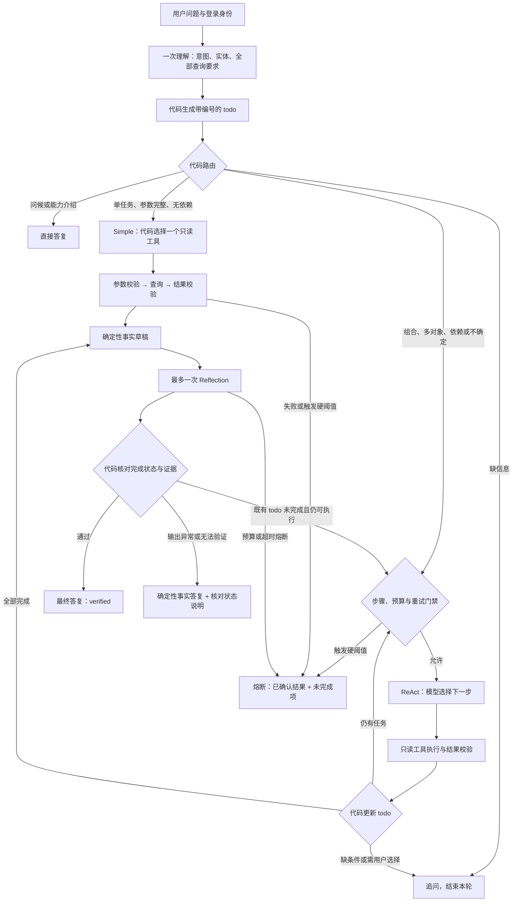

# 影院 Agent：轻重分流、Reflection 与硬熔断

> 实现日期：2026-10-11。普通聊天接口与网站 SSE 共用同一张 LangGraph 状态图。
> 本文描述已落地的代码；144 题、288 次真实 Qwen 扩样验证已完成，见 [扩样评测报告](agent-reflection-expanded-evaluation-2026-10-11.md)。

## 1. 已实现的工作流



轻重链路都是**同一请求内的代码分支**，通过 `route` 区分，不需要新增一次路由模型调用。

### Simple 轻链路

适用：恰好一个可执行任务，参数完整，无发现候选、依赖和多对象迭代，理解置信度至少 0.8。

例如：“OTEST12 的状态”“场次 38 的空座”“《测试电影》的导演”。

流程：理解 → 代码选工具 → 单次查询 → 确定性草稿 → 一次 Reflection → 代码证据检查 → 答复。

- 最多 1 步、1 次业务查询。
- 最多 2 次模型调用：理解与 Reflection。规则可以直接理解的题目可能更少。
- 不请求模型决定调用哪个工具。
- Reflection 不增加查询、不重试、不循环改写。

### ReAct 重链路

适用：多个任务、多个订单/影片/场次、先查场次再查座位，或组合表达、低置信度。

例如：“查《测试电影》今天的场次，再看第一场空座”“分别查询两个订单能否退票及当前规则”。

- 用户要求拆成独立 todo，每项有任务编号、工具、参数、说明和完成状态。
- 每轮模型只选择下一步，代码校验参数与证据来源后执行。
- 完成状态来自真实工具观察，模型说“完成”不能跳过剩余任务。
- 全部完成后立即进入草稿与 Reflection，不再多发起一次决策。
- Reflection 最多一次；若代码发现既有 todo 可继续，仍经过原熔断门禁。续查后只做代码检查，标记 `done_code_checked`，不会再反思一轮。

问候、能力介绍、缺参数追问和现有记忆确认入口直接结束本轮，不强行进入业务查询验收。

## 2. Reflection 如何保证答复有依据

输入只包含本轮问题、todo 进度、已校验的工具观察和事实草稿。模型不绑定工具，不输出内部推理。

示例输出：

```json
{
  "verdict": "pass",
  "missing_tasks": [],
  "missing_items": [],
  "unsupported_claims": [],
  "recommended_action": "finish",
  "revised_answer": "",
  "evidence_order": []
}
```

代码处理规则：

- 通过：代码也必须确认全部 todo 已完成或有权威空结果，才标记 `simple_verified` / `done_verified`。
- 漏项：已有任务未完成时只能继续已有 todo；模型发现原问题未被 todo 覆盖时标记 `verifier_incomplete`，保留已查询结果并说明不完整，不临时扩大执行范围。
- 不支持的陈述、未知任务编号、异常 JSON、工具调用式输出或模型不可用：回退事实草稿。
- 修订：当前只接受**完整事实块的原文与排列**。每个块来自一次工具结果的确定性格式器；`evidence_order` 必须是全部块索引的完整排列。
- 不接受自由改写，也不允许从不同订单的文本中拼接金额、状态或资格。修订稿不满足上述约束就回退，不做第二次模型修订。

这保证模型不能在最终输出中新增事实；它不代表能证明数据库数据本身真实，也不能保证模型发现全部语义遗漏。实际准确率需要真实题集评测。

最终答案在 Reflection 结束后一次性发送；此前只发查询状态。首字时间会包含反思耗时，应与完整耗时分别统计。

### 业务事实优先级

- 身份由服务器传入；订单归属与结果契约继续由代码校验。
- 模型不能把未经查询的陈述夹在追问中输出：是否缺条件由代码判断，追问正文由代码生成。
- 订单当前退票资格以实时订单结果为准。
- 通用退票规则以实时 policy 为准；包含退票内容的检索片段不替代实时规则。
- 非退票知识片段保留在确定性票务答复中，来源继续通过 `sources` 返回。
- 座位明确说明是查询时快照，不表示已锁座。

## 3. 强制熔断与配置

代码为环境配置增加了硬上限；提高环境变量不能把 ReAct 步数提高到 5 以上，也不能把无效调用提高到 3 以上。

```dotenv
AGENT_MAX_STEPS=5
AGENT_MAX_INVALID_CALLS=3
AGENT_MAX_TOOL_CALLS=4
AGENT_MAX_MODEL_CALLS=8
AGENT_MAX_SIMPLE_MODEL_CALLS=2
AGENT_MAX_TOTAL_TOKENS=32768
AGENT_TIMEOUT_SECONDS=65
```

计数口径：

- `step_count`：一次 ReAct 调度/决策及其工具观察计一步。第 5 步完成后若仍需下一步，进入第 6 步前熔断；Simple 固定最多 1 步。
- `tool_call_count`：实际发起的业务执行尝试，失败尝试也计数。重链路默认最多 4 次，可配置到 8；Simple 固定最多 1 次。
- `invalid_call_count`：参数或工具调用格式不合法，单独计数；第 3 次后立即停止。
- 每轮模型最多提出 2 个工具调用；每个调用前重新检查预算、身份、参数和完成状态。
- `model_call_count`：理解、决策、Reflection 的实际尝试总数，包含供应商报错的调用；超过阈值的预检拒绝不计实际调用。
- `reflection_call_count`：实际发起次数，代码固定最多 1 次，没有可放大的 Reflection 环境配置。
- 重链路模型调用硬上限 8，Simple 硬上限 2。最终格式化答复不再调用生成模型。
- 总请求预算默认 65 秒，可配置但不超过 70 秒；单次模型最多 20 秒，单次业务执行最多 15 秒，且均受剩余请求时间限制。
- `recursion_limit=4*max_steps+16` 仅作图执行兜底，默认 36，不替代业务熔断。

### Token 与成本边界

每次模型调用前，按上下文 UTF-8 字节、工具 schema 和最大输出量保守预留预算；返回后用供应商报告的 usage 校正。没有 usage 或调用失败时保留预留额，标记 `usage_missing_calls`，不把缺失用量当作零消耗。

这个预检可能提早拒绝很长的上下文；它是保守预算控制，不是精确计费。代码另有步骤和调用次数硬上限。实际费用按供应商用量与对应价格另算；rerank 服务费用应在原有 rerank 统计中单独计入。

模型 SDK 自动重试设为 0，避免一次已计数调用在底层隐藏重试。当前请求预算相互隔离，不保存在共享模型对象上。

### 熔断出口

任意熔断一旦触发，锁定首个原因，后续不再调用模型、业务工具或 Reflection。最终由格式器输出：

1. 已通过结果校验的查询事实。
2. 未完成任务。
3. 停止原因对应的说明。

没有证据时明确说明未取得可确认结果。相同工具及相同规范化参数重复提出会立即触发 `duplicate_call`；连续两轮没有观察结果或有效纠错进展触发 `stalled`。

典型原因：`max_steps`、`retry_limit`、`tool_limit`、`model_budget`、`token_budget`、`timeout`、`duplicate_call`、`stalled`。

## 4. 接口、追踪与评测

普通 `/ai/chat` 返回值及 SSE 最终 `context` 事件新增：

- `route`、`route_reason`
- `stop_reason`、`circuit_open`
- `step_count`、`tool_call_count`、`invalid_call_count`
- `model_call_count`、`token_usage`
- `reflection_call_count`、`reflection_status`
- `pending_tasks`

SSE 的 `complete` 表示传输正常结束；是否全部完成业务要求，应结合 `stop_reason` 与待办状态判断。

LangSmith 仍只保留白名单中的计数和运行状态，不上传 Reflection 明细、问题、实体或订单内容。评测器按 `agent_stage` 区分理解、决策与反思，汇总路由数量、终止原因、熔断率及平均反思次数，同时保留原有：

- 整题成功率、答案正确率、工具链正确率、多余调用率。
- 首字与完整回答耗时 P50/P95。
- 平均模型调用次数、输入/输出 Token 和费用。
- rerank 专属指标。

真实复评时使用同一冻结题集、同一数据快照、相同模型参数，对新旧链路各重复运行；Simple、组合标准题与组合口语题分开报告。不要把本地模拟测试通过率写成线上事实准确率。

## 5. 改动文件

- [react_agent.py](../cinema-ticketing-backend/cinema-ai/app/react_agent.py)：状态图、轻重分流、草稿、Reflection 和降级出口。
- [agent_budget.py](../cinema-ticketing-backend/cinema-ai/app/agent_budget.py)：请求隔离预算与统一模型计数。
- [reflection.py](../cinema-ticketing-backend/cinema-ai/app/reflection.py)：结构化验收协议及事实块边界。
- [task_progress.py](../cinema-ticketing-backend/cinema-ai/app/task_progress.py)：todo、路由判定、依赖与进度。
- [intent.py](../cinema-ticketing-backend/cinema-ai/app/intent.py)：一次理解提取全部查询类型，兼容“38这场”等口语编号。
- [main.py](../cinema-ticketing-backend/cinema-ai/app/main.py)：普通接口元数据及最终答复。
- [query_answers.py](../cinema-ticketing-backend/cinema-ai/app/query_answers.py)：确定性知识与业务格式器。
- [tracing.py](../cinema-ticketing-backend/cinema-ai/app/tracing.py)：脱敏运行指标。
- [evaluation/run.py](../cinema-ticketing-backend/cinema-ai/evaluation/run.py)、[metrics.py](../cinema-ticketing-backend/cinema-ai/evaluation/metrics.py)：阶段计数及分流/熔断汇总。
- [test_workflow_guards.py](../cinema-ticketing-backend/cinema-ai/tests/test_workflow_guards.py)：工作流边界验收。

## 6. 本地验证与生效

2026-10-11 最初实现验证：137 项回归通过；扩样评测补充检查后，完整回归为 146 项通过，耗时 50.715 秒；新增评测文件的 Ruff 检查通过。离线回归不等于线上准确率，真实任务结果见扩样评测报告。

离线测试使用模拟模型与模拟业务工具，无需虚拟机或 Qwen 调用：

```powershell
cd E:\development\AI-Project\cinema-ticketing-backend\cinema-ai
$testModules = @(rg --files tests -g 'test*.py' | ForEach-Object { ($_ -replace '\\', '.' -replace '\.py$', '') })
& .\.venv\Scripts\python.exe -m unittest @testModules
```

覆盖轻重路由、真实理解调用计数、组合完成即停止、5 步/3 次无效调用熔断、重复查询、模型/Token 预算、异常 Reflection、无证据修订拒绝、续查只反思一次、流式输出验收、取消和并发请求隔离。

代码修改后需要重启 cinema-ai 进程才会用于新请求。本轮真实 Qwen 验证使用隔离实例运行当前源码，本文不代表已经部署到网站正在使用的服务。
