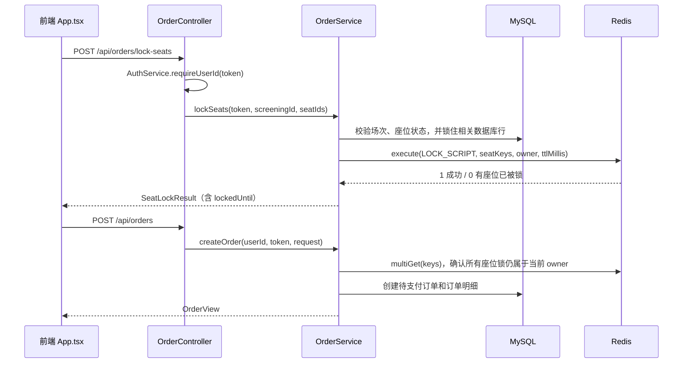

# 项目中的 Redis 脚本锁：从选座到下单

这份说明按项目里的真实调用顺序讲 Redis 锁。先看影院购票的“多人抢同一座位”，再看 AI 网关怎样用 Redis 租约阻止同一个聊天同时生成两份回答。两处都用到了 Redis 原子操作，但解决的问题、键的结构和生命周期不同。

## 先用一句话理解

可以把 Redis 锁想成一张有过期时间的“临时占用牌”：谁先成功放上牌，谁就暂时持有资源；后来的请求看到牌已经存在，就要失败或稍后重试。牌上还写着持有者标识，释放时必须核对标识，不能把别人的牌拿走。

本项目的座位锁使用 Lua 把“检查所有座位是否空闲”和“写入所有座位锁”放在同一段 Redis 脚本里执行。这样两个请求同时抢座时，Redis 会先完整执行其中一个脚本，再执行另一个；后一个就能看见前一个留下的锁。

## 1. 先找到代码入口

- 前端购票入口：[`App.tsx`](../cinema-ticketing-frontend/src/App.tsx#L466) 的 `createOrder()`。
- HTTP 接口：[`OrderController.java`](../cinema-ticketing-backend/src/main/java/com/cinema/ticketing/controller/OrderController.java#L29) 的 `lockSeats()` 和 `create()`。
- 座位 Lua 锁的主体：[`OrderService.java`](../cinema-ticketing-backend/src/main/java/com/cinema/ticketing/service/OrderService.java#L33)。
- AI 网关的 Redis 锁和租约：[`store.py`](../cinema-ticketing-backend/cinema-ai-gateway/app/store.py#L20)。
- 项目整体设计摘要：[`README.md`](../README.md#L50)。

## 2. 购票时完整调用链

前端不是直接碰 Redis，而是先请求 Java 后端。调用顺序如下：



在 [`App.tsx`](../cinema-ticketing-frontend/src/App.tsx#L482) 中，`createOrder()` 先调用 `/api/orders/lock-seats`，成功后生成 `requestId`，再调用 `/api/orders`。两次请求都带同一个 `session.token`。因此锁座成功不等于订单已经创建：第一步先拿临时锁，第二步再把订单写入 MySQL。

### 请求长什么样

前端发给锁座接口的请求体大致是：

```json
{
  "screeningId": 12,
  "seatIds": [101, 102]
}
```

请求头带 `X-Auth-Token`。[`OrderController.lockSeats()`](../cinema-ticketing-backend/src/main/java/com/cinema/ticketing/controller/OrderController.java#L39) 先调用 `authService.requireUserId(token)` 校验登录态，再把 `token`、场次和座位列表交给 `orderService.lockSeats(...)`。

## 3. 座位锁的键和值

[`OrderService.lockKey()`](../cinema-ticketing-backend/src/main/java/com/cinema/ticketing/service/OrderService.java#L489)（文件末尾附近）按“场次 + 座位”组成 Redis 键：

```text
seat:lock:{screeningId}:{seatId}
```

例如：

```text
seat:lock:12:101
```

键值是这次锁的 `owner`；当前调用链把登录 token 作为 `owner` 传入。每个锁设置 5 分钟过期时间，代码常量为 `SEAT_LOCK_TTL = Duration.ofMinutes(5)`。过期由 Redis 自动处理，即使浏览器关闭或后端请求意外中断，锁也不会永久占住座位。

一次选多个座位时，Lua 的 `KEYS` 会同时收到每个座位的键。项目每笔订单最多允许选 6 个座位，见 `MAX_SEATS_PER_ORDER` 和 `distinctSeatIds()`。

## 4. Lua 脚本逐句看

主脚本定义在 `OrderService.LOCK_SCRIPT`：

```lua
for i, key in ipairs(KEYS) do
    if redis.call('get', key) then
        return 0
    end
end

for i, key in ipairs(KEYS) do
    redis.call('set', key, ARGV[1], 'PX', ARGV[2])
end

return 1
```

### `KEYS` 和 `ARGV` 是什么

Java 调用是：

```java
redisTemplate.execute(LOCK_SCRIPT, keys, owner,
        String.valueOf(SEAT_LOCK_TTL.toMillis()));
```

- `LOCK_SCRIPT`：封装 Lua 文本和返回类型的 `DefaultRedisScript<Long>`。
- `keys`：传给 Lua 的 Redis 键列表，对应 `KEYS[1]`、`KEYS[2]` 等座位锁键。
- `owner`：第一个参数，对应 `ARGV[1]`，作为锁的值。
- TTL 毫秒数：第二个参数，对应 `ARGV[2]`。5 分钟是 `300000` 毫秒。
- 返回值：脚本返回 `1` 表示成功，`0` 表示至少一个座位已有锁；Spring 将结果映射成 `Long`。

### 为什么要分两轮循环

第一轮只检查，不写入。只要任何一把锁已存在，就立刻返回 `0`。因为还没开始写，所以不会出现“前两个座位拿到了、第三个座位冲突，前两个却被留在 Redis 里”的常见部分成功问题。

只有第一轮确认所有键都空闲，第二轮才会逐个 `SET`。`SET key value PX ttl` 一条命令同时写入值并设置毫秒级过期时间，避免“写入成功、设置过期时间失败”导致永久锁的间隙。

Redis 执行脚本期间不会穿插执行其他客户端命令，所以另一个抢座请求不能插到“检查”和“写入”中间。**这就是这里使用 Lua 的核心原因：把多条 Redis 操作变成一个不可被其他请求插队的步骤。**

注意：脚本原子执行指的是 Redis 不会让别的请求在脚本中途插入；它不等于跨 MySQL 和 Redis 的分布式事务，也不意味着一般的脚本运行错误会自动回滚已经执行的写操作。

## 5. `OrderService.lockSeats()` 做了哪些事

[`OrderService.lockSeats()`](../cinema-ticketing-backend/src/main/java/com/cinema/ticketing/service/OrderService.java#L61) 按顺序做这些检查和操作：

1. `distinctSeatIds(requestedSeatIds)`：拒绝空列表、重复座位和超过 6 个座位的请求。
2. `screening(screeningId)`：确认场次存在、仍可售，并取得影厅信息。
3. `lockAvailableSeats(hallId, seatIds)`：用 MySQL `FOR UPDATE` 锁住影厅和座位行，避免锁座时座位布局或状态同时被修改。
4. `validateSeats(...)`：确认这些座位属于当前影厅、状态为 `AVAILABLE`，并且当前场次没有未支付、已支付或已出票订单占用它们。
5. `ScreeningCapacity.capture(...)`：保存这场演出的容量快照。
6. `lockKey(...)`：为每个座位生成 Redis 键。
7. `redisTemplate.execute(LOCK_SCRIPT, keys, owner, ttl)`：执行 Lua 批量锁座。
8. 返回 `SeatLockResult`，其中 `lockedUntil` 是服务端按当前时间估算的锁到期时间。

如果 Lua 返回 `0`，`lockSeats()` 抛出 HTTP 业务冲突 `409`，错误信息是“部分座位已被其他用户锁定”。前端捕获后提示失败并刷新座位图。

这里数据库预检查与 Redis Lua 是两个阶段：MySQL 检查业务事实，Redis 脚本解决多个请求抢临时锁的并发问题。数据库事务不能自动撤销 Redis 写入；例如 Lua 成功后数据库事务提交失败，Redis 锁可能继续存在，直到 5 分钟 TTL 到期。这是采用短租约的一个代价和保护边界。

## 6. 锁座之后，怎么确认锁还有效

创建订单时，[`OrderService.createOrder()`](../cinema-ticketing-backend/src/main/java/com/cinema/ticketing/service/OrderService.java#L78) 不会盲目信任前端说“我锁过了”。它会再次检查：

1. 锁住用户数据库行，并用 `requestId` 查找已有订单；重复请求直接返回已有订单。
2. 再校验场次、座位状态和是否已有活动订单。
3. `validateLockOwnership(screeningId, seatIds, owner)` 用 `redisTemplate.opsForValue().multiGet(keys)` 一次读回所有锁。
4. 只有每把锁都存在，并且每个值都等于当前 `owner`，才允许继续下单；否则返回 `409`“座位锁已失效，请重新锁座”。
5. 写入 `ticket_order`、`order_item` 和下单幂等记录，然后用 `orderMessagePublisher.scheduleCancellation(orderNo, ORDER_TTL)` 安排 5 分钟后的超时取消。

因此锁座接口和下单接口之间如果等太久，锁过期后不能继续用旧结果创建订单，必须重新锁座。

## 7. 谁负责释放座位锁

释放逻辑集中在 `unlockSeats(...)`，它对每个座位调用 `redisTemplate.execute(UNLOCK_SCRIPT, List.of(key), owner)`。Lua 内容是：

```lua
if redis.call('get', KEYS[1]) == ARGV[1] then
    return redis.call('del', KEYS[1])
end
return 0
```

这叫“比较持有者后再删除”。不能直接 `DEL key`：假设旧订单的锁已经过期，另一个用户随后拿到了同一个座位；如果旧订单清理任务晚到，直接删除就会误删新用户的锁。Lua 把“读当前值、比对 owner、删除”合成一个原子步骤，旧 owner 只能释放自己持有的锁。

当前主要释放路径：

- 支付成功：`pay()` 把订单变成已出票后调用 `unlockSeats(...)`。
- 用户主动取消未支付订单：`cancel()` 更新订单状态后释放锁。
- 超时取消：`cancelIfUnpaid()` / `cancelOverdueOrder()` 由 RabbitMQ 消费路径或定时对账路径调用，成功取消后释放锁。

即使这些释放调用没有发生，Redis 锁也会在 TTL 到期后自动消失。反过来，TTL 到期也不代表座位可以卖给另一个订单：`validateSeats()` 和 `validateNoActiveOrder()` 还会检查 MySQL 中的活动订单。README 中的设计原则是 **MySQL 保存最终订单事实，Redis 保存短期状态**。

## 8. 这把锁具体保证什么、不保证什么

它保证：

- 多个 Java 后端实例连接同一个 Redis 时，对同一个 `screeningId + seatId` 使用同一个键空间，因此抢同一座位会竞争同一把锁。
- 一个请求选择多个座位时，常规冲突会在写入之前发现，不会留下部分座位锁。
- 锁有 5 分钟 TTL，客户端或服务异常不会无限期占座。
- 释放时核对 owner，旧请求无法误删后来者的锁。
- 同一 owner 再次请求仍会因为 key 已存在而返回冲突；这是**不可重入锁**，并不是“同一用户可以重复加锁”。

它不保证：

- 不能替代 MySQL 事务、唯一约束、订单状态校验或下单幂等。
- 不能把 Redis 和 MySQL 的操作变成一个共同回滚的分布式事务。
- 不能保证锁到期后原请求自动停止。原请求若仍在运行，业务代码还需检查是否仍持有租约；座位下单通过创建订单前的 owner 检查降低这个风险，订单事实再由 MySQL 状态约束。
- 不适合用作长期占座事实。Redis 的锁只是临时协调状态，最终卖出与否以 MySQL 活动订单为准。

并发一致性测试 [`OrderConcurrencyConsistencyTest.java`](../cinema-ticketing-backend/src/test/java/com/cinema/ticketing/service/OrderConcurrencyConsistencyTest.java#L54) 会启动真实 Redis，并在可连接的 MySQL 上通过真实 `OrderService` 施加并发竞争；测试注释也特别说明，mock Lua 返回值的单元测试不能验证 Redis 脚本本身的竞争行为。

## 9. AI 网关的 Redis 租约锁

AI 网关也用 Lua，但它锁的不是座位，而是**一个聊天会话正在生成回答**，并且同时占用一个全局生成并发名额。

关键代码在 [`store.py`](../cinema-ticketing-backend/cinema-ai-gateway/app/store.py#L20)：

- `LEASE_SECONDS = 120`：租约最多保留 120 秒。
- `ACQUIRE_SCRIPT`：一次检查聊天会话、账号当前活动会话、该聊天是否已被占用、全局生成槽位是否已满；成功时写入租约键，并登记全局活动槽位。
- 脚本通过 `redis.call('TIME')` 读取 Redis 服务端时间来清理过期槽位、计算租约截止时间，避免不同应用实例的本机时钟偏差影响这项判断。
- `RedisStore.acquire(session)`：生成 UUID 作为 lease token，调用 `redis.eval(ACQUIRE_SCRIPT, 4, ...)`。返回码 `2` 表示成功；`0` 表示该聊天正在生成；`1` 表示全局繁忙；`3` 表示会话已失效或已更新。
- `RedisStore.release(session, lease)`：通过 `RELEASE_SCRIPT` 释放当前 lease。脚本只有在 Redis 中的 token 仍等于当前调用者 token 时才删除租约，同时移除这个 token 的全局槽位记录。
- `RedisStore.finish(session, record)`：把回答写入历史前再次在 Lua 中检查租约 token 和会话是否有效，防止租约已经过期的旧 worker 把旧回答追加到新会话。

调用入口在 [`main.py`](../cinema-ticketing-backend/cinema-ai-gateway/app/main.py#L370)：聊天请求先执行 `store.rate(...)`，再执行 `store.acquire(session)`。流结束时，`finally` 中执行 `store.finish(...)`，并在其 `finally` 中执行 `store.release(...)`。请求上游生成的总超时是 90 秒，小于 120 秒租约；若 worker 崩溃，Redis TTL 仍会回收租约。

这套机制通常叫**租约（lease）**：占用权不是永久的，而是在限定时间内有效。随机 token 用来证明“当前操作仍是当初拿到锁的那次操作”。它与购票锁的共同点是 owner/token 校验和 TTL；区别是 AI 租约还有全局并发槽位，并用 token 检查迟到的 worker 是否还能写聊天历史。

### AI 反馈也有一把短锁

`RedisStore.feedback_lock(record)` 使用：

```python
redis.set(key, token, nx=True, ex=40)
```

`NX` 表示键不存在时才写入，`EX=40` 表示 40 秒过期。拿不到锁就返回 `409`。释放时 `feedback_unlock()` 用 Lua 比较 token 后再删除，避免一个迟到的反馈请求删掉另一请求的锁。

所以项目里有两种常见“脚本锁”写法：

- 获取时就需要协调多个键或多个判断：把检查和设置放进 Lua，例如座位锁和 AI 生成租约。
- 获取本身只需要一个键：用 `SET key token NX EX seconds` 原子获取，释放仍用 Lua 做“比较 token 后删除”，例如 AI 反馈锁。

另外，`store.py` 的 `RATE_SCRIPT` 和 Java `RateLimitService` 里的 Lua 也会执行 Redis 脚本，但它们是计数和限流，不是锁；读代码时不要只凭“用了 Lua”就把它归类成分布式锁。

## 10. 面试时可以这样讲

> 这个项目的购票锁是基于 Redis Lua 实现的短期、不可重入锁。前端先请求锁座接口，Java 的 `OrderService.lockSeats()` 先检查 MySQL 中场次和座位状态，再按场次和座位拼出 Redis key。Lua 第一轮检查所选座位是否都没有锁，第二轮才统一写入 owner 和 5 分钟 TTL，因此常规冲突不会造成部分锁定。创建订单时再用 `multiGet` 校验所有 key 的 owner 仍然是当前登录会话，然后通过 MySQL 事务保存订单。支付、主动取消和超时取消会调用另一个 Lua 脚本，只有 owner 匹配才删除锁。Redis 负责短期并发协调，MySQL 的订单状态和约束负责最终业务事实；TTL 则处理进程崩溃、客户端离开和锁未释放的情况。

常见追问可以按这几条回答：

1. **为什么用 Lua？** 检查多把锁和批量写入之间不能让其他请求插队，否则会发生超卖或部分占座。
2. **为什么解锁也要 Lua？** `GET` 后在 Java 比较、再 `DEL` 有竞态；这两步之间锁可能过期并被别人拿走。Lua 保证比较和删除一起执行。
3. **锁过期了怎么办？** 创建订单前确认 key 仍存在且 owner 匹配；数据库活动订单校验仍然是最后一道业务判断。
4. **服务挂掉会不会一直锁住？** 不会一直锁住，TTL 会自动到期；但如果 MySQL 订单已经建立，订单状态仍会阻止别的请求卖出同一座位。
5. **Redis 和 MySQL 能一起回滚吗？** 不能。Spring 的 `@Transactional` 管 MySQL 事务，不会回滚已经写入 Redis 的锁，所以短 TTL 和数据库状态校验都很重要。

## 11. 两个实现边界值得记住

- 当前座位锁的 `owner` 是经过 `AuthService` 校验后的登录 token，并且订单会保存 `lock_owner` 供后续释放使用。阅读代码时要知道它不是 Redis 自动生成的 owner。后续若要减少凭证暴露面，可以考虑使用独立的不透明锁标识，并在服务端把它绑定到已认证会话。
- 购票 Lua 一次操作多个 key。项目当前按普通共享 Redis 使用；如果以后改为 Redis Cluster，多 key Lua 需要满足同槽要求，键设计也要相应加入 hash tag 并验证部署配置。

## 12. 建议的源码阅读顺序

1. 看 [`App.tsx`](../cinema-ticketing-frontend/src/App.tsx#L466) 的 `createOrder()`，先知道前端按什么顺序调接口。
2. 看 [`OrderController.java`](../cinema-ticketing-backend/src/main/java/com/cinema/ticketing/controller/OrderController.java#L39)，确认登录 token 如何进入 Service。
3. 看 [`OrderService.java`](../cinema-ticketing-backend/src/main/java/com/cinema/ticketing/service/OrderService.java#L39) 中的两个 Lua 脚本。
4. 看 `lockSeats()`、`createOrder()`、`validateLockOwnership()`、`unlockSeats()`，串起拿锁、核验和释放。
5. 看 `cancel()`、`cancelOverdueOrder()` 以及 [`OrderCancelConsumer.java`](../cinema-ticketing-backend/src/main/java/com/cinema/ticketing/mq/OrderCancelConsumer.java#L29)，理解订单超时后为什么也会释放座位锁。
6. 再看 [`store.py`](../cinema-ticketing-backend/cinema-ai-gateway/app/store.py#L29) 和 [`main.py`](../cinema-ticketing-backend/cinema-ai-gateway/app/main.py#L370)，对比 AI 网关的聊天租约。
