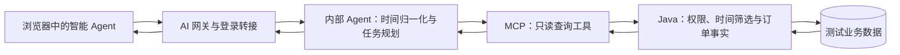

# 网站侧 Agent 回归方案

日期：2026-10-17。状态：实现及隔离验收完成；原网站服务重启被自动审批拒绝，原网站登录冒烟待执行。详见 `website-agent-regression-report-2026-10-17.md`。

## 一、目标与验收范围

确认网站请求经过实际部署的前端、AI 网关、内部 Agent、MCP 和 Java 服务；确认相对时间、连续追问和新票务状态在整条链路中保持一致。

本轮使用网站的“智能 Agent”入口，业务能力为只读查询。重点是相对时间和订单状态，不扩展 Agent 的购票、支付或退款操作能力。

验收链路：

## 二、检查到的现有缺口

1. Java `/api/health` 主要返回存活状态和功能标记；MCP `/health`、Agent `/health` 也不能独立证明网站正在使用本次构建的代码。
2. Agent 已有 `runtime_version`、提示词/规则哈希，但 `versions.py` 的规则文件清单没有覆盖 `main.py` 和 MCP 实现。本次 `REFUNDING` 回答文案恰好在 `main.py`，仅核对现有规则哈希会漏掉这次变化。
3. 网关收到 Agent 的 context 后，主要保存 intent、entities、tool_calls 等信息，没有保留本轮归一化时间摘要和完整的非敏感运行版本证据。
4. Java 的 `/internal/orders/{orderNo}` 尚未向 Agent 返回 `payment_status`、`refund_status`、退款原因类型。对非 ISSUED 订单，退票原因仍可能统一变成“只有已出票订单可以退票”，解释不了退款受理或迟到付款补偿。
5. Agent 已增加 REFUNDING 中文映射，但订单结果校验主要检查 status、订单号和用户归属；缺少支付/退款组合状态的契约约束。
6. 现有 `evaluation/runtime_check.py` 直接请求内部 Agent `/ai/live`，绕过了网站、网关和登录转接，适合内部诊断，不能作为网站完整验收的唯一证据。

## 三、推荐实施顺序

### 阶段 1：建立运行版本证据

为每个组件建立构建清单和启动时固定的运行信息：

- Java：构建标识、提交版本、订单/查询契约版本。
- MCP：构建标识、工具契约版本、实现摘要。
- Agent：构建标识、提示词摘要、完整行为实现摘要、模型与 A/B 分组。
- 网关：构建标识、SSE/转接契约版本。
- 前端：构建标识、实际请求的网关入口。

本地未提交代码通过内容摘要区分，不能只用 Git 提交号。运行版本在构建或进程启动时固定，不能每次请求读取可能已经修改的磁盘文件来代表内存中的执行版本。

版本信息由受保护诊断接口或服务端回归预检采集，不在普通聊天正文展示。记录内容采用白名单，不包含密钥、登录 token、转接凭证、数据库连接信息或绝对密钥路径。

预检将每个组件与本次期望清单比较，并检查契约兼容性；不同组件不要求内容哈希相同。发现旧组件、错误网关目标、无法获取版本证据时标记 BLOCKED，先处理部署一致性。

### 阶段 2：补齐订单查询契约

Java 内部订单查询继续按已核验用户限定归属，并增加：

- `status`：原订单状态，保持现有字段兼容。
- `payment_status`：未发起、支付处理中、已收款、关单处理中或已关闭。
- `refund_status`：无退款记录、PENDING、UNKNOWN 或 REFUNDED。
- `refund_reason_type`：普通退票 CUSTOMER、迟到付款补偿 LATE_PAYMENT 或无记录。
- `can_refund`、`refund_reason`、`server_time`：与网站订单页面采用相同的业务解释。

字段状态值沿用现有 Java 支付模块中的枚举字符串。历史 MOCK 订单和没有支付单的订单允许对应明细为空，不能为了补字段伪造渠道流水。

MCP 保持这些只读事实。Agent 对当前请求所需的字段、允许值和组合关系做校验，缺少关键证据时返回“暂时无法确认”，不能推断为已支付、退款成功或可入场。

确定性回答至少遵守：

- REFUNDING：退款处理中，电影票暂不可使用，不重复引导用户再次退款。
- 退款 UNKNOWN：渠道结果仍在核对，不能承诺到账时间或宣布失败/成功。
- UNPAID + CLOSING：正在核对/关闭交易，不能宣布订单已经取消或座位已经释放。
- CANCELLED + LATE_PAYMENT + PENDING/UNKNOWN：订单已取消，收到的款项仍在补偿退款。
- CANCELLED + LATE_PAYMENT + REFUNDED：订单保持取消，补偿退款已确认，不把订单称为“未付款”。
- ISSUED：以实时 `can_refund` 和具体原因说明退票资格；规则知识不替代本人订单结果。

建议提取共享的订单资格与状态说明逻辑，供网站订单接口和内部 AI 订单接口复用，减少两处文案和业务规则漂移。

### 阶段 3：建立网站入口回归工具

新增专门的网站入口回归器，沿真实认证流程执行：

1. 使用专用测试账号登录，取得正常登录会话。
2. 请求 `/ai-gateway/agent/session`，获取当前 Agent 会话和绑定信息。
3. 请求 `/api/ai/handoff`，取得与当前用户、会话绑定的转接凭证。
4. 请求 `/ai-gateway/agent/chat`，保持网站使用的身份与会话请求头，消费 SSE。
5. 后续追问复用该会话；新场景使用独立会话或正式 reset。
6. 将页面显示、SSE、服务端查询记录与同一份业务事实快照核对。

回归器读取本机忽略目录中的测试账号配置，输出中不保存认证材料。它与直接调用 `/ai/live` 的内部诊断区分记录。

浏览器再执行 6 个代表场景：时间对象澄清、连续修改日期、退款处理中、迟到付款补偿、账号切换、回答停止/异常。验证页面显示、会话绑定和结束状态，不能只验证接口返回 200。

### 阶段 4：关联每一轮证据

复用现有 message_id、Agent trace_id，并按 Java 已支持的 `X-Trace-Id` 建立关联；区分网站请求关联 ID 与 LangSmith 追踪 ID，记录二者映射。

一轮至少记录以下非敏感信息：

- 场景号、轮次、会话测试别名、开始/结束时间。
- 实际参考业务日期、Asia/Shanghai 时区、时间对象、起止日期、软硬条件、澄清原因。
- 各组件构建与契约标识、模型、A/B 分组。
- 实际工具、规范化参数、Java 实际接收的筛选范围、返回事实摘要。
- 订单/支付/退款状态及退票资格摘要，关联到该测试账号拥有的记录。
- 最终回答、结束类型、错误代码、工具与模型调用次数、耗时。
- 关联 message_id、追踪 ID 和服务请求 ID。

网关对 `temporal_summary` 和运行信息做白名单裁剪后保存在受保护的运行记录中；普通聊天界面不增加内部诊断字段。

## 四、测试数据与时间基准

### 数据准备

准备两个独立测试账号，以及以下稳定事实：区间内/区间外上映的悬疑影片、有排期但当前不可购票的影片、可购票场次、空查询结果，以及订单状态用例需要的本人订单。

REFUNDING、UNKNOWN 等瞬态由专用测试库中的受控夹具提供，避免依赖真实沙箱退款恰好停留在某个状态。夹具仅作用于本次测试记录，不覆盖日常订单。测试环境保留网站、网关、Agent、MCP、Java 的真实调用路径。

当前网站先执行只读版本预检与已有数据冒烟。缺少特定状态数据时记录 BLOCKED；不能把不存在的测试状态算作验证通过。

### 时间基准

保留现有固定日期的离线边界回归。网站实际回归以运行时采集的北京时间为依据，每轮生成明确的预期绝对日期，不能沿用历史报告的日期。

例如参考日为 **2026-10-17** 时：

- “本周”：2026-10-12 至 2026-10-18。
- “最近一周上映”：2026-10-11 至 2026-10-17，按现有规则含当天共 7 个自然日。
- “明天”：2026-10-18。
- “下周”：2026-10-19 至 2026-10-25。

“这周的悬疑电影”仍需先澄清是在问上映日期还是可购票场次。确认后保留原题材和归一化范围，不额外调用不必要的业务工具。跨日/跨周追问的边界通过受控时钟的隔离回归覆盖，不修改当前网站的系统时间。

## 五、用例清单：32 个场景

### T：时间解析与查询语义，8 个

- T01：“推荐本周上映的悬疑电影”——上映日期范围，无擅自增加可购票条件。
- T02：“推荐悬疑电影，最好是最近一周上映的，给出上映日期”——滚动 7 天及软性上映日期偏好；“最好”明确修饰上映日期条件。
- T03：“这周有票的悬疑电影”——观影日期范围和 bookable 查询。
- T04：“明晚有哪些场次”——参考业务日期、晚间条件和实际筛选一致。
- T05：“下周有哪些排期”——scheduled 与 bookable 保持区分。
- T06：“只看最近一周上映的”——硬条件，不能偷偷放宽日期。
- T07：不合法日期或相互矛盾的时间——追问，不发出错误业务查询。
- T08：符合条件的结果为空——准确描述空结果，不先宣称存在可订购影片。

### D：连续追问，6 个

- D01：“这周的悬疑题材电影有哪部”→“新上映的”——首轮澄清，次轮保留题材和日期。
- D02：同一模糊首问→“有票的”——确认观影范围，不能误用上映日期。
- D03：确认条件后问“那下周呢”——只更新日期，保留题材及时间对象。
- D04：查询场次后问“晚上呢”——保留影片/影院和已确定日期。
- D05：“最好是最近一周的电影”→确认上映日期——软偏好保留，补充推荐明确标注范围外。
- D06：reset 后只说“有票的”——按新会话缺失条件处理，不借用之前会话或其他账号的信息。

### O：订单和退款，12 个

- O01：未付款订单——说明待付款；不能描述退款已受理。
- O02：关单处理中——不宣称已经取消或释放座位。
- O03：取消且没有收款——说明未收款，无需编造退款。
- O04：已出票且可退——说明当前资格，操作引导至订单页面。
- O05：已出票但超过截止——说明准确截止时间及不可退原因。
- O06：已验票——按事实说明不可退，不能覆盖为普通超时原因。
- O07：REFUNDING + PENDING——处理中、不可使用，不重复申请。
- O08：REFUNDING + UNKNOWN——结果待核对，不承诺具体到账日期。
- O09：REFUNDED——已确认退款，不恢复可用票状态。
- O10：取消后的迟到付款，补偿退款未确认——分别描述取消与退款事实。
- O11：取消后的迟到付款，补偿退款已确认——保留取消状态，说明已退回款项。
- O12：同一会话中状态由 REFUNDING 变为 REFUNDED 后问“现在呢”——重新查询实时数据，回答更新。

### S：身份、契约和结束行为，6 个

- S01：查询其他账号订单——拒绝或无权限，不返回金额/座位等事实。
- S02：登录或转接凭证过期——明确要求重新认证，不能伪造业务结果。
- S03：切换账号——会话和在途响应隔离，不复用上一账号订单或历史。
- S04：MCP/Java 超时或不可用——按查询失败处理，不能包装为“没有影片/订单”。
- S05：订单结果缺字段、未知状态或不兼容契约——安全失败，不猜支付/退款成功。
- S06：SSE 中断与主动停止——中断不显示正常完成；主动停止有明确取消结果；正常完成仅一次且持久化成功。

## 六、通过标准

1. 各组件运行标识与本次期望清单匹配，契约兼容；UP 或 HTTP 200 单独不算通过。
2. 32 个场景逐项记录 PASS、FAIL、BLOCKED 或 SKIPPED；缺测试数据、认证失败和未执行不计 PASS。
3. 时间对象、绝对日期、工具参数、Java 筛选和事实回答一致；允许中文措辞变化，不允许业务含义变化。
4. 澄清轮不发出业务查询，连续追问保留已确认条件；每个场景遵守当前配置的调用预算。
5. 所有订单用例的状态和资格与事实快照一致；退款/关单未确认时，零次宣称已完成。
6. 身份隔离与只读边界零违反；没有下单、锁座、支付、退款工具调用。
7. 正常轮次的回答与结束事件完整，异常轮次有明确结果；网页状态与服务端结果一致。
8. 每条失败都能定位到版本、身份、时间解析、MCP 参数、Java 查询、结果校验、答案组织或 SSE/持久化中的具体一层。

## 七、执行与交付

### 执行顺序

1. 形成预期版本清单与数据清单，采集当前网站版本证据。
2. 补齐状态字段、统一答案规则和诊断信息，先执行隔离的契约/确定性回归。
3. 更新顺序为 Java → MCP → Agent → 网关及必要的前端构建，随后重新预检。
4. 先跑 10 个核心场景：T01、T03、T08、D01、D02、O07、O08、O10、S01、S06。
5. 核心通过后串行执行完整 32 场景，并进行 6 个代表场景的浏览器验收。
6. 失败修复后保留原始结果，重跑失败项和相关联场景，形成复测记录。

网站实测使用项目当前配置的模型；独立测试环境固定模型与 A/B 分组，现有网站的分组按实际运行记录归档。记录实际模型调用次数和 token，用量以运行记录为准。一个场景可能包含多轮，不把场景数当作请求数或费用。

保留 Golden v1 作为冻结留出验收集。新增网站场景另建版本，不把新增支付状态夹具或线上反馈直接写进原冻结集。

### 计划改动位置

- Java：`SystemController.java`、`InternalAiController.java` 及共享订单状态读取逻辑、相关契约回归。
- MCP：`app/mcp_server.py`、`app/mcp_client.py` 的契约/版本信息及参数传递回归。
- Agent：`app/versions.py`、`app/main.py`、`app/react_tools.py`、必要的时间/答案回归。
- 网关：`cinema-ai-gateway/app/main.py` 及运行上下文白名单、持久化和 SSE 回归。
- 前端：`src/chat/chatTransport.ts`、`CinemaAssistant.tsx` 的网站行为验收与必要修复，不添加普通用户可见的内部诊断面板。
- 新增回归入口与独立场景定义：`evaluation/website_regression.py`、`evaluation/website_cases.py`；完整场景文件与输出格式在实施时固定。

### 交付物

- 组件版本与契约预检结果。
- 独立的 32 场景定义、测试数据绑定及预期事实。
- 可重复运行的网站入口回归器。
- 逐轮结果、脱敏诊断证据和浏览器验收记录。
- 汇总报告：通过、失败、阻塞、跳过、失败归因及复测情况。

报告明确区分“隔离回归通过”“原网站部署验收”“真实模型语义通过”，不能将某一层结果替代其他层。本轮已执行隔离网站 32 场景、41 轮及 6 个浏览器场景；原网站仅完成只读版本预检，重启未执行。
