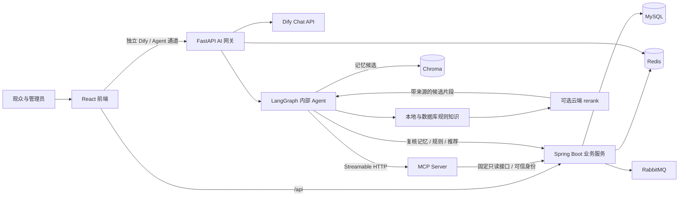

# 影院售票与 AI Agent 项目：面试重点内容及答疑

**版本：V2 · 2026-10-13。** 本版依据当前工作区源码和已有验证报告更新。实测数字均注明历史测量范围；源码已实现、某次测试通过和服务器已部署是三个不同结论。

这份文档用于准备项目介绍和技术面试。建议先熟悉项目主线，再按面试官追问展开细节。回答时优先讲清楚“遇到什么问题、我怎么处理、为什么这样处理、验证结果是什么”，不要只报技术名词。

> **表述口径：** 支付和退款仍为模拟业务；电影/场次/座位/订单查询已接入独立 MCP Server；规则知识使用有界关键词召回及可选云端 rerank；用户长期记忆采用 MySQL + BGE + Chroma。Dify 与 Agent 的窗口和聊天数据已隔离。并发一致性、排序命中率、固定题集任务成功率分别衡量不同问题，不能互相替代。

**本版重点补充：** MCP 迁移与身份边界、排期日期约束与时间范围归一化、Simple/ReAct 双执行路径、分层理解与 GLM 回退、规则验证/一次反思、整轮预算、长期记忆索引一致性、Golden/澄清回流/A/B、账户权限撤销、经营报表和源码自动同步。原有购票一致性问题保留，并修正旧版架构描述。

**阅读顺序：** Java 后端岗位优先准备第 9～22、63～65 题；AI 应用岗位优先准备第 23～33、40～62 题；项目讲解与部署问题准备第 1～8、34～39、66～68 题。先掌握一条端到端业务链，再选择两三个有证据的难点展开。

## 一、先准备两段项目介绍

### 30 秒版本

我做的是一个带 AI 助手的影院售票系统。后端用 MySQL、Redis Lua 和 RabbitMQ 保障选座、幂等下单与超时取消；AI 用 LangGraph 编排 MCP 只读查询，并接入长期记忆和知识重排。重点是购票一致性、用户数据权限，以及通过固定题集评测优化查询完整性与调用成本。

### 约 90 秒版本

这是一个从排期、选座到出票售后的全栈影院项目，包含观众购票、管理员排期、验票、影评审核和经营报表，支付退款目前为模拟流程。

核心交易由 Spring Boot 负责，MySQL 保存事实，Redis Lua 原子锁座，数据库行锁和请求号保证下单/支付幂等；RabbitMQ 延迟取消配合定时对账释放超时订单。这条链路用真实 MySQL 和 Redis 做过并发一致性验证。

AI 部分将 Dify 悬浮球和智能 Agent 窗口隔离。网关确认身份后，LangGraph 选择简单或 ReAct 多步查询，通过 MCP 查询电影、场次、座位和本人订单；任务清单、日期约束、反思和整轮预算限制执行。

长期偏好用 MySQL + BGE + Chroma，规则知识按问题类型使用阿里云 rerank。我用固定题集分别评估工具链、事实、Token 和耗时，明确小样本结果与线上 SLA 的差别。

## 二、系统全貌

### 组件关系

### 各组件分别负责什么

- **React + TypeScript + Vite：** 观众购票和管理员操作界面；处理订单、选座图、影评、聊天和 SSE 展示。
- **Spring Boot：** 登录鉴权、业务参数校验、排期、座位、订单、支付状态、退票、验票和影评等业务规则。
- **MySQL：** 保存票务事实、账户会话版本、用户记忆、记忆索引 Outbox、容量快照和经营报表来源流水。
- **Redis：** 保存短期座位锁、登录 token、目录缓存、AI 会话、限流计数和流式请求租约。
- **RabbitMQ：** 通过延迟队列和死信交换机触发订单超时取消，失败消息有限次重试并进入失败队列。
- **Python AI 服务：** FastAPI 提供 LangGraph Agent，执行分层理解、Simple/ReAct 查询、完成检查、规则验证和必要的反思。
- **MCP Server：** 独立 Python 服务，提供电影、场次、座位、本人订单四类只读工具；Java 继续决定业务规则和订单归属。
- **Chroma + 本地 BGE：** 仅为用户长期偏好建立语义索引，候选需要 MySQL 复核；当前规则知识库仍采用词法召回。
- **AI 网关：** 按独立 URL 与 Redis 命名空间分流 Dify/Agent，校验身份、管理反馈、限流和 SSE，并定期检查生成中的账户是否失效。
- **Docker Compose：** 仓库提供服务编排模板。用户当前 Docker 环境未部署 Nginx；仓库中的 Nginx 配置仅是可选入口方案，不能据此声称服务器正在使用。

### 项目主要数据关系

- 一部影片可以有多个放映场次；一个场次对应一间影厅、一个开场时间和票价。
- 一个影院包含多间影厅；一间影厅维护固定座位布局，并且排期不能重叠。
- 一个订单属于一名观众和一个场次，包含一个或多个座位项目。
- 支付、退款、验票和影评分别保留记录，方便判断订单生命周期及后续处理。
- **订单**是一次购票记录；**电影票**是订单内对应某个座位的入场权益。一单可以包含多张电影票。

## 三、核心业务流程怎么讲

### 1. 浏览与排期

管理员维护影片状态和售票时间窗口，再给影院影厅安排场次。系统区分影片资料、上映中、实际已排期和当前可购买场次：上映中不代表有排期；已排期表示电影院确有场次；可售场次还要满足未开场、销售窗口和影院/影厅启用等条件。“今天排了哪些电影”按北京时间当天的真实排期查询，不允许模型改成全片库或删掉日期。

排期检查使用“开场时间 + 影片片长 + 20 分钟周转时间”计算影厅占用区间，避免前一场未散场、清洁时段和下一场排期重叠。售票开始和结束时间按业务查询实时计算，不需要定时任务改写影片状态。

### 2. 选座和锁座

1. 页面先读取影厅座位布局以及该场次已有订单占用的座位。
2. 登录用户选择最多 6 个座位，服务端检查座位确实属于当前影厅、状态可用且没有有效订单。
3. Redis Lua 脚本先检查所有座位锁是否都不存在，全部可用后再一次性写入锁；只要一个冲突，就一个也不加。
4. 锁带有持有人标识和 5 分钟 TTL。释放时也检查持有人，避免误删其他人的锁。

### 3. 创建、支付和出票

- 创建订单时服务端再次核验场次、座位、Redis 锁持有人和数据库中的有效订单，不能只信任前端座位图。
- 订单金额由服务端用场次票价乘以座位数计算，客户端不提供可信金额。
- 订单先进入 `UNPAID`，有效期 5 分钟；请求号 `requestId` 用于重复提交时返回同一订单。
- 当前支付是模拟成功：写入支付流水后，在同一业务事务中将订单从 `UNPAID` 更新为 `PAID`，再把订单明细标为已出票并将订单更新为 `ISSUED`。因此一次成功响应中通常直接看到 `ISSUED`。
- 支付流水号 `paymentNo` 用于支付幂等；相同订单和相同流水号重试可返回现有订单，冲突流水号会被拒绝。

### 4. 取消和退票

- 观众主动取消只允许操作未支付订单；订单和票项一起改为 `CANCELLED`，然后按持有人释放座位锁。
- 到期订单由 RabbitMQ 延迟消息触发取消。消费者锁定订单行并再次核对 `UNPAID` 和到期时间；如果订单已经支付或取消，就不重复处理。
- 定时对账每分钟扫描过期的未支付订单，作为消息丢失或处理失败时的补偿。
- 只有已出票且未验票的订单可以按规则整单退票。截止时间来自数据库中当前启用的退票政策，校验和更新都由后端执行。
- 当前退款只将订单和票项标记为已退、写入退款记录；没有调用第三方支付渠道退回资金。

### 5. 影片评价和 AI 助手

- 影评人需要有该影片对应的有效已出票票项，且场次已经结束或票项已验票。审核通过并满足观影资格的影评才公开并进入平均分。
- Dify 小悬浮球与智能 Agent 窗口分别处理通用问答和实时查询；桌面可以并排打开，消息、会话、停止操作和反馈各自隔离。Agent 登录后自动申请只读凭证，不再向另一个机器人转移聊天上下文。
- 内部 Agent 仅能查询。下单、支付和退票必须回到正式业务页面，由 Java 服务执行完整校验和状态更新。

## 四、设计重点及面试答疑

每个答案都可以按自己的实际工作调整成第一人称。先说项目里怎么做，再讲这样做解决了什么问题。

### A. 项目和架构

#### 1. 你负责的项目是什么？解决了什么问题？

**回答示例：**

这是一个影院售票全栈项目，主要解决观众找场次、选座下单和查看订单的问题，也提供管理员排期和售后管理。技术上的重点有两个：第一是多人同时抢座时保证座位和订单状态一致；第二是让 AI 能查询实时票务数据，同时不让模型绕过 Java 的权限和交易规则。AI 不直接替用户完成交易。

#### 2. 为什么选择影院售票作为项目场景？

**回答示例：**

影院售票有完整、容易解释的业务闭环：影片和场次管理、座位竞争、订单、支付、超时释放、退票和验票。它既有常规 CRUD，也有并发和状态机问题，能展示我如何把具体业务规则映射到数据库、缓存和消息处理里。再加上 AI 问答后，可以说明模型如何在权限受控的情况下调用现有业务能力。

#### 3. 整体架构是怎样的？

**回答示例：**

前端使用 React；Java Spring Boot 是票务业务入口，MySQL 保存业务事实，Redis 保存锁、登录和短期会话，RabbitMQ 处理延迟取消。AI 侧由网关、LangGraph Agent 和 MCP Server 分工：网关管理身份及独立聊天通道，Agent 决定受约束的查询步骤，MCP 将四类只读工具映射到 Java 接口。长期记忆的向量索引在 Chroma，业务原文和归属仍由 MySQL 决定。

#### 4. 为什么不是把所有代码都放在一个服务里？

**回答示例：**

票务核心业务目前采用 Java 模块化单体，影片、订单、评价等模块仍在一个 Spring Boot 服务中。这样订单和座位变更可以直接使用同一数据库事务，也减少服务间调用和分布式事务复杂度。AI 服务单独拆出，是因为 LangChain、LangGraph 和模型 SDK 属于 Python 生态，AI 迭代和 SSE 长连接也适合独立部署。代价是多了内部 HTTP、服务凭证和部署配置，需要明确边界。

#### 5. 为什么 AI 不直接连 MySQL？

**回答示例：**

如果把数据库账号交给模型或 Agent，查询范围、订单归属和 SQL 都会更难控制。我把查询封装成固定的 Java 内部接口，Java 用参数化查询并根据可信身份限制本人订单。模型只能选业务工具、传查询条件，不能拼任意 SQL。这样权限和业务规则仍由熟悉业务状态的 Java 服务决定。

#### 6. 为什么选 Spring Boot、MyBatis 和 JdbcTemplate？

**回答示例：**

Spring Boot 负责 Web、依赖管理、事务、Redis 和 RabbitMQ 集成，适合组织核心业务服务。项目里部分账户和影院查询使用 MyBatis Mapper；一些通用管理查询和动态 SQL 使用 JdbcTemplate，减少大量重复 Mapper 样板代码。并不是所有数据库访问都强行套在 MyBatis 上，复杂查询仍保持参数化和服务层校验。

#### 7. 数据库主要有哪些实体？

**回答示例：**

核心包括用户、影片、影院、影厅、座位、场次、订单、订单明细、支付流水和退款记录。影片关联场次，影院关联影厅，影厅关联座位；订单关联一个用户和一个场次，订单明细记录各个座位。支付和退款独立成记录，避免把所有生命周期信息塞进一个订单字段里。

#### 8. 影片状态和售票状态有什么区别？

**回答示例：**

影片的上映阶段、电影院是否安排场次、此刻能否购买是三层条件。上映中可能没有排期；已排期必须能查到实际场次；已排期也可能已经开场或尚未开放销售，因此不一定可购买。项目用 `catalog/showing/scheduled` 区分影片查询范围，用 `scheduled/bookable` 区分场次范围，并将用户日期作为独立约束。

### B. Redis、数据库和购票一致性

#### 9. Redis 锁座具体怎么保证原子性？

**回答示例：**

普通写法是先逐个查座位锁，再逐个设置锁。两个请求可能同时查到“都没人锁”，最后都认为自己成功。项目使用 Lua 把“检查全部锁”和“设置全部锁”放在 Redis 的一次原子执行中：先检查全部 key，只要有冲突立即失败；只有全部通过才统一设置，并配置 5 分钟过期时间。

**通俗解释：** 就像售票员先检查一组座位是否全部空着，确认后一次性挂牌；不会先挂上两个，再发现第三个已被别人选走，留下半组锁。

#### 10. 为什么 Redis 锁之外还要查 MySQL？

**回答示例：**

Redis 锁解决短时间内多人同时操作的问题，但锁会过期、可能被清理，也不代表已经成功下单。MySQL 中的有效订单才是已经占座的持久事实。创建订单时我会再次锁定座位数据库行、检查有效订单和 Redis 锁持有人；只有数据库与锁都符合条件，才创建订单。这是“快速协调”和“持久状态”两层保护。

#### 11. 座位锁为什么要有持有人校验和 TTL？

**回答示例：**

持有人校验保证释放动作只删除自己设置的锁，避免用户 A 的请求误删用户 B 的锁。TTL 负责处理浏览器关闭、断网或用户离开等没有执行显式解锁的情况。TTL 到期后锁自动释放，但创建订单时仍会在 MySQL 检查是否有有效订单，所以不能把 TTL 当成订单状态。

#### 12. 什么是幂等？项目里如何实现？

**回答示例：**

幂等就是同一操作因为重试执行多次，最终结果仍像执行了一次。网络超时后，前端可能不知道下单是否成功，于是会重试。创建订单带 `requestId`，同一用户重复提交会找回并返回已有订单；数据库唯一约束也防止同一请求号出现多笔记录。支付使用 `paymentNo` 判断重复流水。

**注意补充：** 幂等键要有作用域。这里下单幂等键结合用户身份和请求号，不是全站只看一个请求号。

#### 13. 为什么总价必须由服务端计算？

**回答示例：**

浏览器里的价格可以被修改，不能作为支付和订单事实。服务端根据数据库里该场次的票价和通过校验的座位数量重新计算订单金额，再写入订单。前端只负责展示，后端负责最终金额和状态校验。

#### 14. 支付流程和状态机怎么设计？

**回答示例：**

待支付订单只能从 `UNPAID` 进入支付流程。后端先锁定订单行，检查订单归属、状态和过期时间，再插入唯一支付流水；随后将订单更新为 `PAID`，把票项标记为 `ISSUED`，最终把订单更新为 `ISSUED`。这些数据库更新在一个事务内完成。重复使用相同流水号可以返回已有成功结果，不同流水号不能重复支付同一订单。

#### 15. 这个项目接了什么支付渠道？

**回答示例：**

目前没有接真实支付渠道。前端使用演示支付流水号，后端模拟支付成功并验证订单状态、流水号幂等和出票流程。这样可以验证系统内部订单闭环，但不能说已经完成真实扣款或资金退款。后续接支付平台时，需要增加支付回调验签、金额核对、回调幂等、退款接口和对账。

#### 16. 为什么一个订单既有订单状态，又有票项状态？

**回答示例：**

订单代表一笔购买交易，票项代表订单里每个座位对应的入场权益。整单退票时两者都会更新；验票通常需要精确到一张票，某一张票验票后也能用于阻止整单退票。两层状态各自描述不同对象，不能简单合并。

#### 17. 退票规则为什么放数据库，不写死在代码里？

**回答示例：**

退票截止时间和说明可能调整。如果写死在代码中，每次规则变化都要重新发布服务。规则放在数据库后，管理员可以管理当前启用策略，订单详情、AI 查询和退票校验都读取当前策略。前端显示的倒计时只是提示，最后是否可退仍由后端重新校验。

#### 18. 如何防止支付与超时取消同时发生？

**回答示例：**

支付和超时取消都要检查订单状态，并通过数据库订单行锁串行处理。支付路径要求订单仍是未过期的 `UNPAID`；取消路径也只允许把 `UNPAID` 改为 `CANCELLED`。谁先成功改变状态，另一条路径重新读取后就不能再做相反的转换。座位释放也按锁持有人校验。

### C. RabbitMQ 与异步任务

#### 19. 订单超时取消的消息链路是什么？

**回答示例：**

订单创建事务提交后，发布一条带过期时间的延迟消息到延迟队列。消息过期后经死信路由进入取消队列，消费者再检查订单是否仍未支付并已经到期，然后更新订单和票项、释放 Redis 锁。消费者使用手动 ACK，失败时最多重试 3 次，最后进入失败队列。

#### 20. 为什么延迟消息不能直接取消订单？

**回答示例：**

消息可能延迟、重复投递或在用户支付后才到。消息只是“该检查这笔订单了”的通知，不是取消命令。消费者必须以数据库当前状态为准，只有订单仍处于 `UNPAID` 且已到期才取消。这样即使消息晚到或重复，也不会误取消已支付订单。

#### 21. RabbitMQ 失败后怎么补偿？有没有事务消息？

**回答示例：**

当前创建订单的消息在数据库事务提交后发布，避免数据库回滚但消息已经发出。不过，数据库提交成功后如果发布消息失败，仍然存在消息缺失窗口。项目用每分钟扫描过期未支付订单的定时对账任务补偿这种情况；消费者自身也有有限重试和失败队列。

订单延迟消息链路尚未采用 Transactional Outbox。后续可以把待发事件与订单放进同一数据库事务，再由发布器重试投递并增加告警。对账任务多实例可能重复扫描，条件更新能保护结果，但仍可以改进领取机制。需要区分模块：长期记忆索引已经实现 MySQL Outbox，不能因此声称订单消息也具备相同保证。

#### 22. 消息消费如何幂等？

**回答示例：**

消息带稳定的 `messageId`，消费时先写入 `message_consume_record`。如果该消息 ID 已处理，唯一约束会让重复消息直接跳过。幂等记录和订单取消在同一个数据库事务中：取消失败时事务回滚，记录也回滚，后续重试仍能处理。

### D. AI、LangGraph、RAG 和权限

#### 23. 为什么同时用 Dify 和内部 Agent？

**回答示例：**

Dify 承接常见说明和通用聊天，内部 Agent 查询实际场次、座位、本人订单和退票资格。现在是 Dify 悬浮球与 Agent 原窗口两个独立入口，桌面可并排打开；服务端按 `/ai-gateway/dify/*`、`/ai-gateway/agent/*` 以及独立 Redis 前缀隔离历史、绑定、生成锁、停止标记和反馈。它们共用网站身份校验和基础服务，但不传递对话或长期记忆。接口名中的 handoff 现在表示 Agent 授权，前端会自动申请。

#### 24. LangGraph 在这里做什么？流程有几步？

**回答示例：**

当前共享图有 `prepare/clarify/simple/agent/tools/draft/reflect/respond` 八类节点，普通和流式问答共用。`prepare` 完成理解和槽位校验，由代码选择简单查询或 ReAct 多步查询；工具返回后检查真实任务是否完成，再生成草稿、验证并输出。复杂问题允许模型原生 `tool_calls` 循环，执行始终受到白名单、参数来源、完成清单和预算约束。这里的 ReAct 是 Agent 工具循环，与前端 React 框架是两个概念。

#### 25. Agent 能调用哪些业务工具？

**回答示例：**

模型侧开放六个只读业务工具：`search_movies`、`search_screenings`、`query_seats`、`query_order`、`query_ticket_policy`、`recommend_movies`，另有追问控制工具 `ask_user`。前四个通过 MCP，后两个复用规则检索和 Java 推荐接口。退票资格由订单返回的 `can_refund/refund_reason` 配合规则查询解释，不是单独开放一个退款执行工具。模型不能调用任意 SQL、锁座、下单、支付或退款。

#### 26. 项目里接入 MCP 了吗？

**回答示例：**

已经接入。电影、场次、座位和本人订单迁到独立 MCP Server，使用官方 Python SDK、Streamable HTTP 和 MCP 的 `initialize/tools/list/tools/call` 协议。Agent 通过客户端调用 MCP，MCP 再访问固定 Java 接口。迁移统一了工具发现、参数 Schema 和结果/错误封装；Java 的订单归属、权限和业务规则仍然保留。当前仅在可信内部服务之间调用，不提供终端用户 OAuth。

#### 27. RAG 是怎么做的？用的是什么向量库？

**回答示例：**

需要按用途回答。规则知识库读取 `cinema-ai/knowledge/` 的三个 Markdown 和 Java 已发布知识，采用约 500 字符切片、80 字符重叠、有界关键词召回、去重及可选的 `qwen3.7-text-rerank`，默认候选上限 30、选取前 4。纯退票规则问题有确定性快路径，会跳过云端重排。Java 当前政策单独保留，不能被检索片段覆盖。

Chroma 已实际用于用户长期记忆，向量由本地 BGE 生成；它没有用于这条规则知识的初始召回。面试中可以讲向量检索，但要讲清楚部署在哪条链路，避免把“项目用了 Chroma”扩大成“所有 RAG 都是向量召回”。

#### 28. 如何避免 AI 编造票务信息？

**回答示例：**

实时订单、场次、座位和退票资格以 Java 查询为准，通用知识保留来源，长期记忆只补充偏好。代码检查日期、范围、ID 来源和返回结构，任务清单检查必要对象及字段是否完成；草稿再经过规则验证或一次结构化反思。验证失败时保留已核实事实并披露不足。这个机制降低错误风险，但反思与固定验收都不能证明自然语言回答永远正确。

#### 29. 如何保证 Agent 查询的是当前登录用户自己的订单？

**回答示例：**

前端在 Agent 会话中自动申请短期只读凭证，Java 校验当前登录并绑定会话和权限范围。网关解析得到可信用户 ID 后传给 Agent；MCP 客户端在服务端设置 `X-Internal-Token` 与 `X-AI-User-ID`，用户 ID 不进入模型工具参数。Java 最终按订单号和用户 ID 同时查询。账户会话版本变化后，旧登录和旧 Agent 凭证也会在下次核验失效。

#### 30. Agent 怎么处理缺少订单号或不完整的问题？

**回答示例：**

槽位预检会先检查订单号、场次编号和有效日期，明确缺失时可以直接澄清，避免为必然缺信息的问题调用模型。补问只读取本用户、Agent 本渠道的受限历史，并保留原任务的退票资格或场次意图；用户切换话题时重新判断。模糊的多候选场次可以 `ask_user`，助手历史里猜测的 ID 不能当成可信参数。

#### 31. AI 会话为什么放 Redis？模型调用失败怎么办？

**回答示例：**

Redis 保存各渠道短期会话、有限历史、限流和生成锁，使不同 worker 可以承接请求。长期偏好另存 MySQL，不随“新对话”清空。GLM 路由失败可在剩余预算内回退 Qwen；重排失败保留关键词候选；没有可用聊天模型时，仅对能确定理解并查到事实的任务执行有界查询与模板回复。Java 身份核验失败时拒绝授权，不能为了可用性沿用旧登录缓存。

#### 32. 为什么用 SSE？网关是否只是多了一层转发？

**回答示例：**

SSE 用一个 HTTP 长连接推送执行状态和最终答复，浏览器可以及时显示查询进度。网关还承担登录核验、通道隔离、生成租约、限流、停止操作和协议转换；停止会取消下游图任务。内部规划、草稿和反思不是正式聊天内容，客户端收到进度也不代表任务已完成，要检查最终结束事件。增加网关的代价是更多部署组件和故障定位环节。

#### 33. AI 回答评价如何落库和同步？

**回答示例：**

用户可以对回答点赞或点踩，并补充原因。网关只接受属于当前会话的回答 ID，从服务端保存的回答快照取得原问题、答案和 Agent 上下文，再把明确提交的评价保存到 Java/MySQL。Dify 回答会尝试同步到 Dify；如果同步失败，本地反馈记录仍保留并显示同步状态。管理员可以在后台筛选和处理反馈。内部 Agent 评价不会伪装成 Dify 评价。

### E. 测试、结果和项目边界

#### 34. 如何验证并发正确性？

**回答示例：**

我增加了并发一致性测试，让多个真实线程同时进入订单 Service；Redis 使用真实执行 Lua 脚本的嵌入式 Redis，数据库连接到真实 MySQL，并保留 Spring 事务代理。测试包括 200 个线程抢 1 个座位、100 个线程使用同一 `requestId`、300 个线程抢 50 个座位，以及 50 个线程使用同一支付流水号。四类场景各重复 3 轮，重复锁定、重复订单、超卖和重复支付结果都是 0。可用 `mvn -Dtest=OrderConcurrencyConsistencyTest test` 复现；测试需要可连接的 MySQL。

#### 35. 这个并发测试能说明 QPS 是多少吗？

**回答示例：**

不能。它直接调用 Service，目的是检验竞争条件下数据有没有重复或不一致；没有经过 HTTP、Nginx、网络和完整 RabbitMQ 链路，测试连接池上限也为 64。因此我不会从这组数据推算或宣称 QPS。要测吞吐，需要另做端到端压测，明确硬件、并发模型、数据库连接池、响应时间分位数和错误率。

#### 36. 测试中的 RabbitMQ 是真实的吗？

**回答示例：**

并发一致性测试把消息发布器 mock 掉，因为该测试重点是 Redis 锁、MySQL 唯一约束、事务和订单状态竞争，不测消息中间件链路。订单取消有单元测试和实际消费者实现，但不能把这份并发报告说成完整 RabbitMQ 集成压测。完整验证应另起真实 Broker 测试延迟投递、重复消费、失败重试和死信路径。

#### 37. 项目目前有哪些明确限制？

**回答示例：**

支付与退款仍为模拟；规则知识仍存在词法召回的局限，长期记忆虽然有向量索引，也需要 SQL 复核。订单延迟消息尚无 Outbox，既有并发报告也不覆盖 HTTP 吞吐和完整 RabbitMQ 链路。最新固定题集仍有标准题、口语组合与澄清补问的失败，GLM 该轮没有实际接管理解。源码功能不能直接代表服务器已完成同版发布或具备生产 SLA。

#### 38. 如果继续做，你会优先改进什么？

**回答示例：**

交易侧优先补订单消息 Outbox、失败告警以及真实中间件的端到端验证。AI 侧已经有固定题集，下一步按失败样本修复退票语境误查影片、口语组合漏字段和澄清补问工具链，再冻结新版做成对复测。GLM 接管、知识召回扩展和成本收益都要单独验收；真实支付接入则需要供应商沙箱、回调验签、金额对账和退款状态处理。

#### 39. 你认为这个项目最值得讲的技术难点是什么？

**回答示例：**

我会讲并发下的座位和订单一致性。最开始只看 Mockito 单测，发现它们可以伪造 Redis 返回值，却不能证明 Lua 真执行、数据库唯一约束真生效。于是我用真实 Redis 和 MySQL 搭并发测试，让线程同时抢座、重复下单和重复支付，再用数据库查询交叉核对结果。这个过程不仅验证了“数据没有重复”，也促使我区分正确性测试和吞吐量测试，不能拿并发线程数冒充 QPS。

### F. MCP、查询语义与多步执行（新版）

#### 40. 为什么“今天排了哪些电影”不能直接查上映中的电影？

**回答示例：**

上映描述影片阶段，排期描述电影院有没有真实场次。用户问今天的排期，查询条件必须包含 `movie_scope=scheduled` 和北京时间当天日期，后端通过场次关联电影；只查 `ON_SHELF` 会把没有排期的电影也返回。反过来，今天有排期不代表此刻还能购买，需要另外使用 `bookable` 条件。

**追问要点：** 空排期是合法结果。不能为了给出电影列表，偷偷改成上映列表、查询明天或删除日期。

#### 41. 怎样固定北京时间，并区分影片上映时间和场次时间？

**回答示例：**

代码按 `Asia/Shanghai` 取得本轮唯一的基准日期，把“今天”固定为该日期。模型提出工具参数后，执行层再次用原问题约束时间和业务范围，返回结果也检查是否满足条件。查询当天使用 `[当天零点, 次日零点)`，跨午夜的场次按开场日归属。范围查询的单日字段可以为空，但起止条件必须完整保留；不能把用户指定的日期整体丢掉。

工作区还新增 `time_normalization.py`：按表达含义区分 `release` 与 `screening`，保留起止日期、时段、硬条件/软偏好及歧义状态，处理近期明确天数、星期、月份和起止区间。比如“本月上映的电影”约束影片上映日，“今晚有哪几场”约束场次开场日及时段；“最近”未说明范围、年份不明确或日期冲突时应澄清。不能把一个时间条件套到所有业务对象上。

这项时间范围扩展需单独验证配套 Agent/MCP/Java 版本。2026-10-11 的固定评测早于该扩展，不能作为新增范围的测试证明；旧查询文档中“仅单日”的历史说明需要按实际源码版本辨别。

#### 42. MCP 与原来的普通 HTTP Tool 相比，具体增加了什么？

**回答示例：**

原来的工具名称、参数和调用方式由 Agent 自己约定。现在 MCP Server 提供标准工具列表、JSON Schema、初始化握手、调用结果和错误封装；其他可信 MCP 客户端也可以发现同一批工具。Agent 和 Java 中间多了一个标准协议边界，但数据权限、业务语义和数据库事务仍由应用实现，MCP 本身不保证这些规则正确。

本项目真正迁移的是四类查询工具，不是把全部业务 REST API 都改成 MCP，也没有把模型 API 变成 MCP。

#### 43. 工具 Schema 能保证参数安全吗？

**回答示例：**

Schema 只能保证结构、枚举或类型符合要求。一个正整数场次 ID 可能仍属于模型猜测，合法订单号也可能属于别的用户。因此执行层还要检查来源：订单号来自用户表达，场次 ID 来自用户明确提供或本轮校验后的场次结果；模型侧场次查询使用关键词，不让模型猜电影/影院数据库编号。身份由服务端传递，Java 再检查归属。

MCP 客户端每次调用建立独立会话及身份头，避免并发用户共享可变身份。即使持有内部服务令牌，也必须先认证真实用户，不能让普通浏览器持有该令牌。

#### 44. “查场次，再查最早一场空座”如何避免漏查或反复调用？

**回答示例：**

程序建立场次、选择最早场次、座位等子任务及依赖。先查用户日期和影片对应的真实场次，再从校验后的结果解析最早场次 ID，最后查它的座位。每个结果更新任务状态；全部完成就停止，模型提前结束时只补未完成项，相同参数的重复调用会被拒绝。

“执行过 search_movies”还不代表“导演和片长已回答”，因此任务检查还关注用户要求的字段。预算不足时披露未完成部分；多个候选又无法确定用户选择时追问。

#### 45. Java 日志里 `/mcp` 返回 404，该怎样判断？

**回答示例：**

先看返回错误的是哪一个服务。项目中 Java 监听 8080，MCP 是独立的 8020；如果 `cinema-ticketing-backend` 的 `http-nio-8080` 记录 `/mcp` 404，能确认请求到达 Java，但不能凭它判断 MCP 容器是否宕机。应核对 Agent 的 `CINEMA_MCP_URL`、实际容器网络和端口映射，再检查 MCP 自己的日志及 `/health`。

Docker 内部通常使用 `http://cinema-mcp:8020/mcp`；当前模板不发布 8020，容器内的 `127.0.0.1` 也只指自身。用户当前环境没有 Nginx，排查不能先假设存在反向代理。OAuth 发现路径返回 404 还可能是客户端探测了项目没有实现的 OAuth 接口；它与 MCP POST 地址配置错误要分别判断。

依据：[MCP 实现与启动](docs/cinema-mcp.md)、[查询范围与日期规则](docs/ai-query-semantics.md)、[多步执行修复](docs/agent-reliability-fixes-2026-10-10.md)。

### G. 长期记忆、RAG 与 rerank（新版）

#### 46. 用户记忆究竟保存在 Redis、MySQL 还是 Chroma？

**回答示例：**

三者保存不同对象。Redis 保存本渠道最近的聊天和短期控制状态；MySQL 保存用户明确允许跨会话使用的记忆原文、归属、渠道、状态和版本；Chroma 保存 BGE 生成的向量和检索元数据。新对话会重置短期聊天，用户保存的长期偏好仍然存在。MySQL 是记忆事实来源，Chroma 是可以重建的检索索引。

#### 47. 写 MySQL 成功、写 Chroma 失败怎么办？

**回答示例：**

用户记忆和 `ai_memory_index_outbox` 事件在同一个 SQL 事务提交，避免业务成功却没有索引任务。独立 worker 领取有租约的任务，对 Chroma 做幂等 upsert/delete；失败重试，崩溃后租约到期可重领。同一记忆按事件顺序处理，并校验版本与租约，迟到的旧任务不能确认新的租约。

这是最终一致的异步索引，不是 MySQL 与 Chroma 的跨库原子提交。索引滞后时读取当前 SQL 记忆，也提供管理员重新排队重建能力。订单消息仍使用另一套 after-commit 加对账补偿机制。

#### 48. 向量库还没删完，用户删除的记忆会不会被继续使用？

**回答示例：**

不能直接使用向量库返回的正文。Chroma 检索先按用户和 Agent 渠道过滤，再把候选 ID、版本交给 Java，按 MySQL 当前归属、有效状态和版本重新核验；最终使用 SQL 返回的有效原文。删除在 SQL 中先失效，向量稍后清理，因此旧候选无法通过复核。索引故障回退时也重新读取 SQL，避免沿用编码前的旧快照。

删除目前采用墓碑，SQL 仍保留原文。停止参与回答与物理清除原文是两个验收条件，当前不能声称已经完成所有副本的隐私擦除。

#### 49. 是否所有聊天都会自动变成长期记忆？

**回答示例：**

当前保存需要用户控制：可以在“我的记忆”手动管理，或者说“请记住……”后确认保存。普通对话不会自动落库，每个账号最多 200 条、每条最多 500 字。用户可以修改和删除，更新需要版本检查。Dify 不读取这套 Agent 记忆。

记忆只能影响稳定偏好、推荐和表达习惯；当轮明确要求优先，票价、座位、订单状态和退票资格仍实时查询。自动归纳普通聊天、偏好去重与用户级停用等属于后续扩展。

#### 50. Embedding、向量召回、rerank 在项目里分别做什么？

**回答示例：**

长期记忆用本地 `bge-small-zh-v1.5` 把文本编码成 512 维向量，Chroma 用向量寻找与当前问题相近的记忆候选，再做 SQL 复核。规则知识则先用词法方法找候选，必要时把“问题 + 候选片段”交给 `qwen3.7-text-rerank` 排序。重排负责排列已经召回的内容，无法找回从未进入候选集的知识。

当前没有将 Chroma、云端 rerank 和 Dify 串成一条统一知识链；每条链路的用途、数据外发范围和故障策略都需要分别说明。

#### 51. 为什么有 rerank 还要保留原始规则？失败怎么办？

**回答示例：**

当前退票政策是 Java 的实时结构化业务事实，不参加片段重排或裁剪。通用片段可能有旧版本或相似表述，不能覆盖 `cutoff_minutes` 以及具体订单的 `can_refund/refund_reason`。规则正文与分钟参数曾出现冲突，已经通过共享格式器统一生成截止说明。

重排没有候选、只有一个候选、关闭开关或进入纯退票确定性路径时可以跳过。密钥、超时、限流、传输或响应校验失败时回退关键词候选，保留来源及实时政策；默认限制为 Top K 30、Top N 4、5 秒超时、每进程 4 个并发，不自动重试。当前外发的是规则问题与知识片段，电影/座位/订单 MCP 查询和长期记忆不进入这个重排接口。

依据：[长期记忆设计与落地](docs/agent-long-term-memory-chroma.md)、[rerank 接入说明](docs/agent-rerank-dashscope.md)、[规则一致性修复](docs/agent-reliability-fixes-2026-10-10.md)。

### H. 分层路由、反思、预算与评测（新版）

#### 52. 每个问题都要先调用大模型理解吗？

**回答示例：**

当前会先做确定性的槽位预检，缺少订单号、有效日期或场次编号时直接追问；高频明确问题由 L0 规则处理。未覆盖的问题再尝试符合接管范围的 GLM 前置路由，无法接管或复杂问题保留 Qwen 完整理解。代码根据任务结构选择 Simple 或 ReAct，而不是把所有问题都交给模型自由规划。

项目还保留可选 fastText 分类器及训练脚本，但没有证据证明它已经训练上线或贡献本轮收益，面试中不能把“有扩展代码”说成“已取得模型效果”。

#### 53. GLM 返回 0.95 置信度，就可以直接执行吗？

**回答示例：**

不能。当前默认接管阈值是 0.90，但置信度是模型自报，必须同时验证结构、单任务范围以及影片/影院关键词能否追溯到用户原文。日期和业务编号由代码提取，用户身份由服务端提供，分类器不能创建这些参数。上下文代词、组合查询、连座偏好、推荐和复杂规则等不会随意交给短路由模型。

GLM 默认只尝试一次、6 秒超时，忙碌或冷却时跳过，失败在剩余总预算内回退 Qwen；失败调用也计预算。该次评测零接管时，只能说明回退得到验证，不能估计正常接管时的分类准确率。

#### 54. Simple 与 ReAct 的选择标准是什么？

**回答示例：**

一个明确对象、一个查询目标且没有跨工具依赖时，Simple 可以直接执行确定性只读查询。需要“先查影片/场次，再用真实场次编号查座位”、多个订单或组合规则解释时，使用 ReAct 的有界工具循环。两条路径最终都进入事实草稿和验证边界，Simple 也不是免校验快捷通道。

这可以减少简单问题的模型决策轮次，同时为组合问题保留分步能力。只有能证明覆盖完整目标的条件才走快路径，避免把复杂口语错误地归为一个高频意图。

#### 55. Reflection 是让另一个模型重新回答一次吗？

**回答示例：**

当前先由工具事实形成原子证据块；简单且可证明完整的任务走代码规则验证，其余最多执行一次结构化 LLM reflection。反思检查遗漏任务、缺少字段和无支持断言，不允许携带新的工具调用。接受修订时，代码要求保留全部完整证据块和记录关联，只允许符合校验的重排，拒绝自由改写事实。

有真实未完成任务且仍有预算时，ReAct 可以继续执行受控补查；反思自身不能无限递归。模型说“通过”不等于事实一定正确，所以独立评测仍然需要单独的验收项。

#### 56. 怎样防止 Agent 进入死循环或超出调用成本？

**回答示例：**

当前代码默认每轮业务调用 4 次、无效/重复调用最多 3 次、ReAct 最多 5 步、聊天模型最多 8 次、Token 预算 32768、共享期限 65 秒，配置也有边界。Simple 默认模型调用上限 2 次，GLM 已尝试失败并升级 Qwen 时可为最终核验保留受控例外，但仍受全局预算限制。

调用前先预留输入与最大输出预算，得到供应商 usage 后再对账；没有 usage 就保留保守预留，不能当零消耗。次数、Token 或总期限触发熔断后停止后续模型和工具调用，返回已有核实结果及未完成说明。应用外层 `/ai/live` 还有 80 秒超时；它与图内 65 秒预算是不同层。

**注意：** 以上来自当前 `react_agent.py/agent_budget.py` 的默认值，运行环境可在代码允许范围内覆盖。云端 rerank 的调用与 usage 单独统计，不能把聊天模型预算叫作供应商全部接口的完整账单上限。

#### 57. 提示词改了以后，怎样知道一次实验究竟用了哪个版本？

**回答示例：**

提示词包在 `prompts/v1/`，版本注册在 `config/agent_versions.json`，响应和脱敏 trace 记录实验组、规则/提示词版本及内容/配置哈希。进程固定加载一套提示词，修改代码或提示词后需要重新加载。按可信用户、会话和实验编号的哈希分组，补问保持同组，客户端不能自己选 A/B。

离线对比还保存源码、配置和业务快照；报告拒绝把不同指纹混成同一版本。历史与新版比较只取共同题集，新增加的问题单独报告，避免改变分母制造提升。

#### 58. 澄清之后用户补充的信息，能直接拿去训练模型吗？

**回答示例：**

补槽回流只是弱标签。当前仅在同一可信用户和会话、30 分钟内补齐有效槽位且后续查询通过验证时，将脱敏问题对写入本地 SQLite，标记为 silver 并要求人工复核。不保存用户令牌或工具业务记录，同一问题对只累加出现次数。

冻结 Golden v1 有 168 条，包含原 144 条和新增 24 条补问变体，标准/口语各 84 条，合计仍是 72 个独立场景。Golden 用于验收，不用于训练调参；训练/验证/测试按 `source_case_id` 隔离，防止同场景的不同问法泄漏。用户补问有效，仍不能证明原意图和整个答案标签都正确。

#### 59. 评测里的“成功率”和“准确率”有什么区别？

**回答示例：**

严格任务成功要求预设事实验收、工具名称/参数/顺序验收和流正常结束同时通过。事实检查可能通过但多查了无关工具，任务仍失败；正确追问且没有业务调用也可以成功。还单列多余调用、澄清、结束状态、Token、模型次数和首片段/完整耗时 P50/P95。

2026-10-11 的 168 题 × 2 轮 × A/B 共 672 次任务是真实开发环境的单并发评测，经过 Java/MySQL/Redis 与模型，但计时在 `Assistant.live` 内，不包括网关认证和浏览器渲染。它验证固定场景，不是 HTTP 压测、线上成功率或逐句人工事实审核。冻结日期和业务快照改变时，要产生新版本验收。

#### 60. 这版优化能拿出哪些数字？GLM 带来的收益是多少？

**回答示例：**

按 2026-10-11 保存报告，共同 144 题、每题两轮的同题比较中，历史严格成功为 254/288，新 A 和新 B 均为 278/288，即 88.2% 到 96.5%；B 相对历史的平均聊天模型调用下降 44.0%、已观测聊天 Token 下降 36.2%。这是当次整体优化的结果。

完整 168 题每组为 316/336，约 94.0%，不能把共同子集的 96.5% 当完整集合结果。GLM 实际尝试 14 次、接管 0 次，A/B 成功数相同，所以不能将提升归因于 GLM，也不能据此宣称“增加第二个模型更准更便宜”。历史对比不是同一时刻运行，耗时还受负载/缓存影响；口语组合事实与补问工具链仍有回归，需单独整改。

#### 61. rerank 的首位命中率到 100%，是否说明问答准确率到 100%？

**回答示例：**

不代表。2026-10-09 的排序专项只有 10 道有答案题和 2 道无答案题、两轮测量，有答案题首位证据命中率从 90% 到 100%。它测量冻结候选的顺序，不经过完整意图、工具循环和最终生成。同期 96 次 Agent 开关对照没有显示端到端严格成功提升。

当时还暴露完整自然语言 `LIKE` 召回为空、当前规则正文与数值冲突、候选比 Top N 还少等问题，后来针对召回和规则一致性做了修复。重排无法修复未召回内容或错误业务事实；扩大知识覆盖和候选规模后还需要重新冻结同题评测。

#### 62. LangSmith 记录了什么？能用 trace 直接计算回答准确率吗？

**回答示例：**

项目使用脱敏摘要追踪节点、模型/工具阶段、耗时、结束原因、受控错误码和可用的 usage；通过 `trace_id` 关联网关与 Agent。云端不上传完整问题、聊天历史、订单数据或密钥，使用会话散列；本地按用户会话归档，保留本地用户标识以便排查。默认只允许配置为本地/测试/预发时开启本模块追踪。

没有原问题、真实结果和独立标签的 trace 只能支持阶段定位、资源统计及结束率，不能直接推算事实准确率。`/health` 显示 tracing enabled 也只证明配置启用，云端交付需要回读确认。

依据：[成本与规则快路径](docs/agent-cost-routing-optimization-2026-10-11.md)、[GLM/Golden/回流设计](docs/agent-glm-golden-feedback-ab-2026-10-11.md)、[672 次真实 A/B 报告](docs/agent-glm-ab-evaluation-2026-10-11.md)、[rerank 专项](docs/agent-rerank-evaluation-2026-10-09.md)、[追踪说明](docs/agent-langsmith-tracing.md)。设计文档早于实测的“未执行”描述按对应日期理解，新的实测结果以单独报告为准。

### I. 账户安全、经营报表与运行维护（新版）

#### 63. 管理员降权后，旧登录为什么会立刻失效？

**回答示例：**

MySQL 保存 `users.session_version`，Redis 登录记录保存登录时版本。每次受保护请求重新检查账户存在、启用状态、角色与当前版本，修改密码、退出全部设备或管理员变更角色/状态会递增版本。旧 token 即使仍在 Redis 且没到 TTL，也无法再授权。

Agent 凭证绑定原登录 token，解析时也走同一核验；正在生成的网关回答每两秒复核身份。这里的“即时”是下一次授权校验失效，不强制回滚已经获准进入事务的操作，也不撤回已经发出的字。直接 SQL 改权限也必须同时递增版本。

#### 64. 经营报表怎样保证金额不会重复，也不会算错日期？

**回答示例：**

支付额和毛售出票数按支付日，退款额按退款处理日，有效票和上座率按放映日，全部使用北京时间。退款可能来自之前支付的订单，所以某天窗口净额可以为负；退票也不会抹掉原先的成功支付流水和毛售出票数。

支付、退款、票数分别聚合后按日期/影院/影片合并，避免一笔支付联表两个票项后金额翻倍。金额用 `DECIMAL/BigDecimal`，新退款显式存北京时间 `refunded_at`，旧 TIMESTAMP 升级按瞬时值转换。页面和 CSV 都标记模拟数据，导出限条数、按页读取并处理公式前缀。

#### 65. 上座率为什么需要场次容量快照？

**回答示例：**

如果分母直接使用今天的影厅座位数，管理员后来增删座位就会改变历史上座率。当前首次成功锁座事务在影厅行锁保护下固定 `AVAILABLE` 座位数，失败随事务回滚；一个座位记录按一张票计，停用座位不计。有未结束且固定容量的场次时冻结相关布局，历史快照不随以后调整变化。

有效票要求父订单已出票且票项有效，已验票仍计算，这是销售占座比例。整体使用有效票合计除以容量合计，不平均各场百分比。旧订单缺快照时显示未知，范围内含未知容量就不展示整体比例；也不能把零容量或无场次伪装成 0%。

#### 66. 修改 AI 代码后如何确保启动了新版本？

**回答示例：**

先按服务边界定位：Java 8080、内部 Agent 8000、网关 8010、MCP 8020；本地 Chroma 8030，索引 worker 没有 HTTP 端口。Python 模块、知识文档、提示词或 `.env` 改动通常需要重启读取它们的进程；Java 改动需要重新构建并启动新 JAR，静态前端需要重新构建发布。重启后检查服务自身日志、健康接口和真实查询，不能只看端口有人监听。

本地启动使用后端目录的 `start-ai-local.ps1 -Service agent/mcp/gateway` 等参数；同名服务已运行时先停止，`all` 适合整组停止后启动。服务器应核对实际 Compose 服务、环境变量、网络和镜像版本，不能套用本地端口或假设 Nginx 存在。

#### 67. “内部agent”目录是运行目录还是实时备份？

**回答示例：**

服务从原后端运行，`内部agent/源文件/` 是单向同步的最新源码副本。2026-10-13 已配置本机后台轮询和 Windows 登录自动启动，保存后通常 1～3 秒反映到副本；新增、改动、重命名和删除都会同步，清单保存 SHA-256。首次验证的 160 个文件逐个核对一致，隔离检查和真实目录的增删改验证通过；后续文件数量随源码和清单变化。

实际 `.env`、密钥、运行数据、模型和虚拟环境不复制。直接改副本会被覆盖，源文件删除也会同步，所以它提供最新副本，不提供历史恢复；历史使用 Git，数据库另做备份。源码复制完成不代表进程热更新，也不代表服务器自动部署。

#### 68. 面试时怎样选择最值得展开的新版难点？

**回答示例：**

我会按岗位选一个主线。后端主线讲抢座、幂等、事务和补偿，再用经营报表说明事实建模；AI 主线讲“上映当作排期”的实际错误，如何用语义分层、日期约束、MCP、任务清单和独立验收修复；数据一致性主线讲 MySQL 记忆与 Chroma 索引怎样通过 Outbox、租约、版本和 SQL 复核保证可恢复。

每个难点都讲触发案例、原风险、实现位置、验证方式及仍然存在的边界。对成本优化给出共同题集的结果，同时说明 GLM 零接管和子集回归，比只列 LangGraph、MCP、RAG 名词更容易经受追问。

依据：[账户撤销](docs/account-security.md)、[经营报表](docs/sales-reports.md)、[源码同步规则](内部agent/README.md)。

## 五、面试官可能继续追问的技术词

- **原子执行：** 执行期间不会被其他请求穿插。项目 Lua 先检查全部锁再批量写入，正常冲突路径不会留下半组锁；Redis 脚本的原子执行不能扩大成 Redis 与 MySQL 的跨系统事务保证。
- **TTL：** 数据自动过期时间。座位锁 TTL 是临时保险，订单是否支付仍由数据库状态决定。
- **幂等：** 对同一个请求重复执行，业务结果仍只有一份，例如网络超时后的下单重试不会多出订单。
- **数据库行锁：** 暂时锁住一行，让竞争请求排队处理，避免两个事务同时把同一订单从未支付改成不同状态。
- **事务：** 一组相关数据库更新作为整体提交或回滚。出票时订单状态和票项状态应保持一致。
- **死信队列：** 消息过期、拒绝或重试失败后的去向，便于隔离失败消息和后续排查。
- **补偿任务：** 定期重新检查业务事实并修复漏处理的情况。本项目扫描过期未支付订单，补偿超时取消消息没有成功处理的情况。
- **SSE：** 服务器通过一个保持打开的 HTTP 响应，逐段向浏览器发送文本或状态事件，常用于流式回答。
- **RAG：** 先检索与问题相关的资料，再把资料作为回答上下文。它能提供依据，但检索质量仍需评估，也不能替代实时业务校验。
- **Agent 工具：** 由应用预先定义的业务函数。模型可以在允许范围内选择工具，但工具本身由程序执行，权限和参数校验仍由后端控制。
- **MCP：** 工具发现和调用协议。本项目使用独立服务提供四类只读工具，服务鉴权及业务归属仍需应用实现。
- **ReAct：** 模型基于工具结果选择下一步的有界循环；与前端界面框架 React 区分。
- **Embedding：** 文本的向量表示。当前本地 BGE 为长期记忆编码，模型或预处理变化时要重建对应索引。
- **Rerank：** 根据当前问题对已召回候选重新排序，不负责扩大初始召回集合。
- **Outbox：** 在业务事务中一并保存待处理事件，再由 worker 异步消费；项目已用于记忆索引，订单延迟消息尚未采用。
- **租约与版本：** 租约限制任务当前由谁处理、何时可重领；版本限制该结果是否仍对应最新业务状态。
- **Reflection：** 对草稿和证据的受约束检查；最多一次模型反思，简单情况由代码规则验证。
- **Golden / silver：** 冻结验收样本与待人工复核的弱标签样本，不能直接混用为训练集或准确率分母。
- **P50 / P95：** 一半/95% 样本不超过的耗时；应用首片段、完整回答与网页端到端耗时需要分别定义。
- **会话版本：** 账户持久化的授权代次。撤销时递增，旧登录版本不匹配后拒绝授权。

## 六、回答时要坚持的事实边界

### 可以明确讲

- Redis Lua 用于原子检查并批量锁座，锁有 5 分钟 TTL，并校验锁持有人。
- MySQL 是订单状态和最终占座依据；下单金额由后端计算。
- 下单使用 `requestId` 幂等，支付使用 `paymentNo` 幂等。
- 未支付订单通过 RabbitMQ 延迟取消，并由定时扫描补偿。
- 2026-09-26 并发一致性复测使用真实 MySQL 和执行 Lua 的 Redis，四类场景各重复 3 轮，记录的重复锁定、重复下单、超卖和重复支付均为 0；这是该次版本的测试记录。
- MCP 已接入四类只读查询；模型侧业务工具白名单、身份来源、日期和参数由代码限制。
- Dify 与 Agent 入口、Redis 历史和生成控制隔离；Agent 长期记忆由用户确认，MySQL 持久化、Chroma 检索后复核。
- 规则知识采用词法召回及按问题类型使用的云端 rerank；实时退票政策独立保留。
- Simple/ReAct 共用图、完成检查、规则验证/最多一次模型反思和整轮熔断预算。
- 账户会话版本与 AI 身份核验、销售/退款报表和场次容量快照已有源码实现及对应验证说明。
- 672 次真实模型 A/B 报告区分共同 144 题和完整 168 题；GLM 零接管、子集回归与排序收益均如实披露。

### 不要夸大

- 不要说“QPS 达到多少”。现有并发测试不是吞吐量压测。
- 不要说“接入支付宝/微信支付”或“真实退款成功”。当前没有真实支付渠道。
- 不要说“规则知识全部已经向量召回”。Chroma/BGE 目前用于用户记忆，规则知识使用另一条召回与重排链路。
- 不要说“MCP 自动保证鉴权、已公开所有业务能力或已提供 OAuth”。这些不由协议名称决定，当前四类 MCP 工具是内部服务。
- 已有真实 Qwen/rerank 评测不代表 Dify 的线上效果和远程稳定性也经过同样验证。
- 不要说“消息绝不丢失”或“MySQL 与 Chroma 强一致”。记忆索引采用 Outbox 和版本复核的最终一致，订单消息仍有提交后发布窗口。
- 不要说“Agent 能自动帮用户退票、支付”。这些交易写操作不开放给 Agent。
- 不要把 mock 消息发布器的 Service 并发测试说成 RabbitMQ 的端到端压力测试。
- 不要把 LangChain Tools 的存在说成模型可以任意执行工具。业务流程只允许固定工具与受控参数。
- 不要将规则验证通过率、排序 Top1、意图命中率、严格任务成功率或流正常结束率混成“问答准确率”。
- 不要将共同题集 96.5% 当完整 168 题的 94.0%，或把总任务次数当独立问题数量。
- 不要将整体降本归因于本轮未接管的 GLM；缺少供应商 usage 的保守预留也不等于真实账单。
- 不要将记忆墓碑当作原文物理擦除，或将源码自动同步当作历史备份、服务热更新和服务器自动部署。

## 七、最后的答题方法

遇到熟悉的问题，按这个顺序组织回答：

1. **先说场景：** 例如多人同时抢同一个座位。
2. **再说风险：** 普通的先查后写会让两个请求都看到座位空闲。
3. **讲项目做法：** Redis Lua 原子锁座，MySQL 行锁和有效订单复核，订单请求号幂等。
4. **给验证证据：** 说明真实 MySQL/Redis 的并发测试规模和结果。
5. **讲清边界：** 该测试证明一致性，不代表 QPS；支付渠道也仍是模拟实现。

这样回答能让面试官听到的不只是用了哪些组件，还能听明白你解决了什么问题、实现在哪一层、结果由什么证据支持。

## 八、源码与证据定位

准备具体答案时可以从以下入口核对；这些链接指向本项目文件，不包含环境密钥。历史报告的数字只对应报告中冻结的版本、题集与环境。

- **交易一致性：** [OrderService](cinema-ticketing-backend/src/main/java/com/cinema/ticketing/service/OrderService.java)、[并发一致性测试](cinema-ticketing-backend/src/test/java/com/cinema/ticketing/service/OrderConcurrencyConsistencyTest.java)、[历史复测记录](cinema-ticketing-backend/压测报告.md)。
- **共享执行图、时间约束与任务完成：** [react_agent.py](cinema-ticketing-backend/cinema-ai/app/react_agent.py)、[react_tools.py](cinema-ticketing-backend/cinema-ai/app/react_tools.py)、[task_progress.py](cinema-ticketing-backend/cinema-ai/app/task_progress.py)、[time_normalization.py](cinema-ticketing-backend/cinema-ai/app/time_normalization.py)。
- **MCP：** [mcp_server.py](cinema-ticketing-backend/cinema-ai/app/mcp_server.py)、[mcp_client.py](cinema-ticketing-backend/cinema-ai/app/mcp_client.py)、[MCP 运行说明](docs/cinema-mcp.md)。
- **知识与重排：** [policy_retrieval.py](cinema-ticketing-backend/cinema-ai/app/policy_retrieval.py)、[reranker.py](cinema-ticketing-backend/cinema-ai/app/reranker.py)、[KnowledgeSearchService](cinema-ticketing-backend/src/main/java/com/cinema/ticketing/service/KnowledgeSearchService.java)。
- **长期记忆与 Outbox：** [memory.py](cinema-ticketing-backend/cinema-ai/app/memory.py)、[memory_worker.py](cinema-ticketing-backend/cinema-ai/app/memory_worker.py)、[AiMemoryService](cinema-ticketing-backend/src/main/java/com/cinema/ticketing/service/AiMemoryService.java)、[记忆表定义](cinema-ticketing-backend/src/main/resources/ai-memory-schema.sql)。
- **分层理解、验证与预算：** [intent_routing.py](cinema-ticketing-backend/cinema-ai/app/intent_routing.py)、[glm_router.py](cinema-ticketing-backend/cinema-ai/app/glm_router.py)、[rule_verifier.py](cinema-ticketing-backend/cinema-ai/app/rule_verifier.py)、[reflection.py](cinema-ticketing-backend/cinema-ai/app/reflection.py)、[agent_budget.py](cinema-ticketing-backend/cinema-ai/app/agent_budget.py)。
- **版本与澄清回流：** [versions.py](cinema-ticketing-backend/cinema-ai/app/versions.py)、[版本注册](cinema-ticketing-backend/cinema-ai/config/agent_versions.json)、[clarification_feedback.py](cinema-ticketing-backend/cinema-ai/app/clarification_feedback.py)、[Golden v1](cinema-ticketing-backend/cinema-ai/evaluation/golden/v1/README.md)。
- **通道与账户安全：** [独立聊天说明](docs/ai-chat-isolation.md)、[网关 store.py](cinema-ticketing-backend/cinema-ai-gateway/app/store.py)、[AuthService](cinema-ticketing-backend/src/main/java/com/cinema/ticketing/service/AuthService.java)、[撤销与升级](docs/account-security.md)。
- **报表与容量：** [SalesReportService](cinema-ticketing-backend/src/main/java/com/cinema/ticketing/service/SalesReportService.java)、[OccupancyReportService](cinema-ticketing-backend/src/main/java/com/cinema/ticketing/service/OccupancyReportService.java)、[ScreeningCapacity](cinema-ticketing-backend/src/main/java/com/cinema/ticketing/service/ScreeningCapacity.java)、[报表口径及验证](docs/sales-reports.md)。
- **评测与运行追踪：** [2026-10-11 A/B 实测](docs/agent-glm-ab-evaluation-2026-10-11.md)、[2026-10-09 排序专项](docs/agent-rerank-evaluation-2026-10-09.md)、[LangSmith 摘要追踪](docs/agent-langsmith-tracing.md)、[AI 源码索引](docs/ai-implementation/source-index.md)。
- **源码副本：** [同步规则与状态](内部agent/README.md)、[同步工具](内部agent/同步工具/sync_agent.py)。
